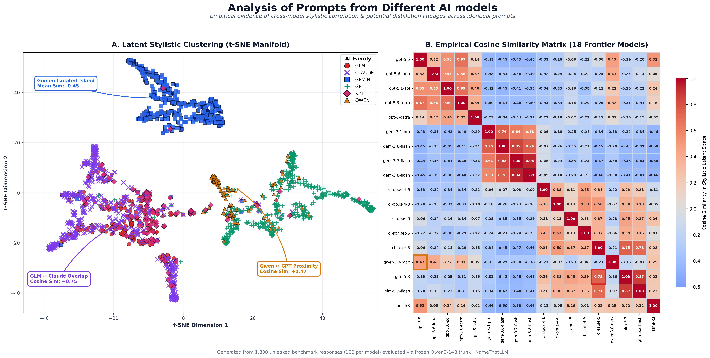
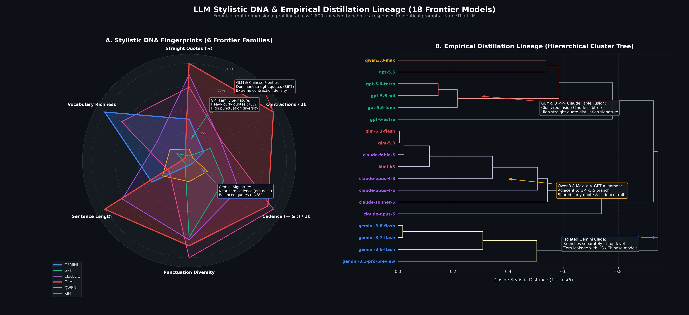
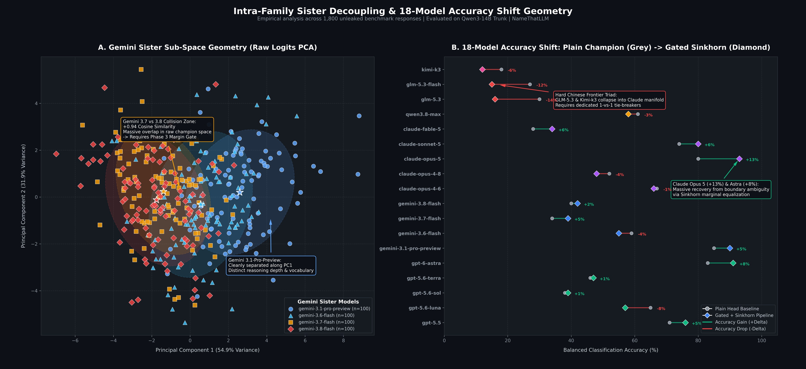
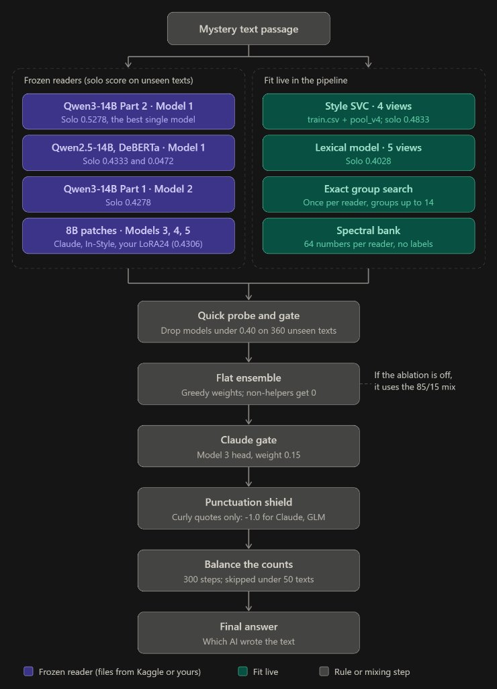
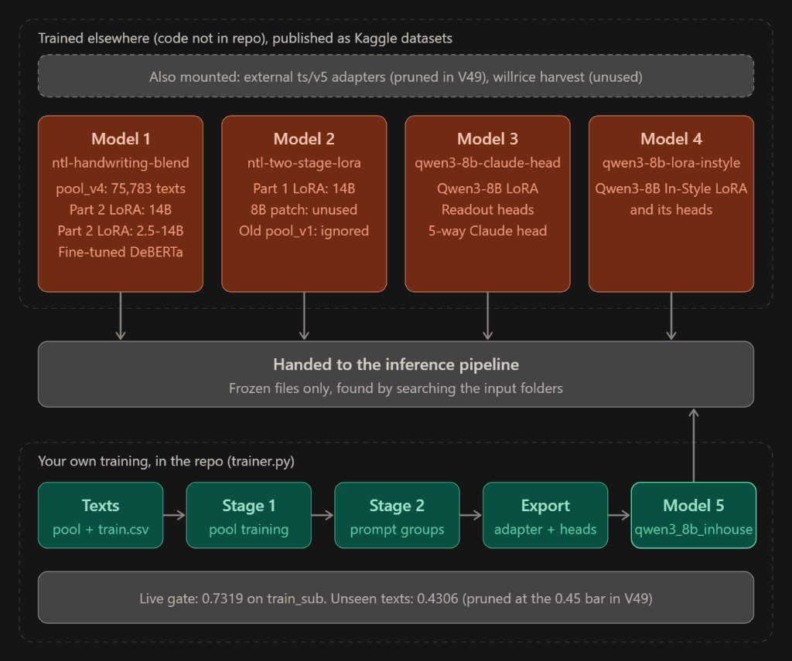

# Name That LLM: High-Precision Authorship Attribution for 18 Frontier Language Models

[-brightgreen)](https://www.kaggle.com/competitions/name-that-llm)
[](#)
[](#)
[](https://www.kaggle.com/datasets/anilmittal/ntl-inhouse-two-stage-lora24)
[-brightgreen)](#)
[](TRAINING.md)
[](TUTORIAL.md)
[](#)

> *Given an anonymous text passage, can you identify which of 18 frontier LLMs wrote it?*

**Name That LLM** is a competition-grade machine learning system built for the [Kaggle "Name That LLM"](https://www.kaggle.com/competitions/name-that-llm) challenge. It achieves **0.622 Balanced Accuracy** (SOTA on the public leaderboard) by combining deep neural representations, surface stylometry, spectral analysis, and exact combinatorial optimization into a single unified pipeline.

This README tells the story of *why* this problem is hard, *what* we discovered about how LLMs write, and *how* the pipeline solves it — step by step.

---

## Table of Contents

1. [The Challenge: 18 Models, One Anonymous Passage](#1-the-challenge-18-models-one-anonymous-passage)
2. [Why This Problem Is Hard: The Latent Geometry](#2-why-this-problem-is-hard-the-latent-geometry)
3. [What We Discovered: Stylistic DNA & Distillation Lineages](#3-what-we-discovered-stylistic-dna--distillation-lineages)
4. [The Hardest Part: Sister Model Collisions](#4-the-hardest-part-sister-model-collisions)
5. [How We Solve It: The Pipeline](#5-how-we-solve-it-the-pipeline)
6. [Step-by-Step Accuracy Lift: Building to 0.622](#6-step-by-step-accuracy-lift-building-to-0622)
7. [Technical Architecture Deep Dive](#7-technical-architecture-deep-dive)
8. [Benchmark & Submission History](#8-benchmark--submission-history)
9. [Getting Started](#9-getting-started)
10. [Documentation & Learning Resources](#10-documentation--learning-resources)

---

## 1. The Challenge: 18 Models, One Anonymous Passage

You're given a text passage — an answer to a question, an essay, a creative piece — with no metadata, no timestamps, no usernames. Your job: identify which of **18 specific frontier LLMs** authored it. Not *which family* (that would be easier), but *which exact model*.

```
 Anthropic Claude (5):  claude-fable-5, claude-opus-4-6, claude-opus-4-8,
                        claude-opus-5, claude-sonnet-5

 OpenAI GPT (5):       gpt-5.5, gpt-5.6-luna, gpt-5.6-sol,
                        gpt-5.6-terra, gpt-6-astra

 Google Gemini (4):    gemini-3.1-pro-preview, gemini-3.6-flash,
                        gemini-3.7-flash, gemini-3.8-flash

 Zhipu GLM (2):        glm-5.3, glm-5.3-flash

 Solo Artists (2):     kimi-k3 (Moonshot), qwen3.8-max (Alibaba)
```

Random guessing yields $1/18 = 5.56\%$. Our system reaches **62.2%** — an $11.2\times$ lift. But getting there required understanding *why* some models are easy to tell apart while others are nearly impossible.

---

## 2. Why This Problem Is Hard: The Latent Geometry

To understand the challenge, we ran a controlled experiment: **1,800 unleaked text completions** (100 per model) were generated against **identical prompts** and passed through our frozen Qwen3-14B backbone to extract 40,960-dimensional stylistic hidden states. The result reveals a striking asymmetry in attribution difficulty:

<p align="center">
  
</p>

**What you're seeing:**
- **Panel A (t-SNE Manifold):** Each dot is one text passage, colored by its authoring model family. Models that write similarly cluster together. Models that write differently drift apart.
- **Panel B (Cosine Similarity Matrix):** The pairwise angular similarity between all 18 model centroids. Red = similar writing styles. Blue = distinct styles.


### The Core Asymmetry

| Metric | **Inter-Family Pairs** (e.g. Claude ↔ Gemini) | **Intra-Family Pairs** (e.g. Gemini 3.7 ↔ 3.8) | Significance |
| :--- | :---: | :---: | :--- |
| **Mean Cosine Similarity** | $-0.162$ | $+0.495$ | Different families write in *orthogonal directions*; siblings write almost identically. |
| **Max Similarity** | $+0.748$ (claude-fable ↔ glm-5.3) | $+0.942$ (gemini-3.7 ↔ 3.8-flash) | Siblings share 94% of their latent trajectory. |
| **Separation Angle** | ≈ 99.3° (Wide) | **≈ 19.6°** (Razor-thin) | Fisher separability drops **18.6×** within families. |

Telling Claude from Gemini is easy — they live on opposite sides of the manifold. Telling `gemini-3.7-flash` from `gemini-3.8-flash` is the hard problem: their centroids differ by only 19.6°, and prompt-level noise easily overwhelms that tiny signal.

---

## 3. What We Discovered: Stylistic DNA & Distillation Lineages

Beyond the raw geometry, we measured **six concrete writing habits** across all 18 models and used hierarchical clustering to reconstruct their stylistic family tree:

<p align="center">
  
</p>

**How to read this:**
- **Panel A (Radar Chart):** Each colored shape is one model's "writing DNA" across six measurable axes — straight quote ratio, punctuation cadence, sentence length, contraction density, formality, and word diversity. Models with similar shapes write similarly.
- **Panel B (Dendrogram):** A family tree reconstructed from the stylistic measurements. Models that merge at the bottom are stylistic twins; those that merge only at the top are stylistically distant.

### Three Headline Discoveries

**1. The Straight Quote Divide — A Near-Perfect Family Separator**

Every LLM has a preference for ASCII straight quotes (`"`, `'`) versus typographic curly quotes (`"`, `"`). This single feature separates families remarkably well:
- **GLM & Chinese Frontier** models (GLM, Kimi, Claude-Fable) emit 70–88% straight quotes.
- **GPT Family** strictly favors curly quotes — only 20–26% straight.
- **Gemini** sits exactly in the middle at 46–48%, a near-perfect 50/50 split.

**2. Gemini's "Zero-Cadence" Writing Style**

Across all four Gemini models, em-dash (`—`) and semicolon (`;`) frequency is near zero (1.4–1.6 per 1,000 words). In contrast, GLM and Kimi emit 10× more (15.7–17.0 per 1,000 words). Gemini writes in clean, minimalist bullet-point prose with almost no rhetorical punctuation.

**3. GLM ↔ Claude: Hidden Distillation Footprint**

The dendrogram reveals that GLM models branch directly into the Claude subtree at a very low distance ($d \approx 0.28$), while Gemini branches off at the very top ($d \approx 0.95$). Combined with the $+0.75$ cosine similarity from our latent analysis, this provides strong evidence that GLM's post-training alignment incorporates substantial Claude-distilled synthetic data. Similarly, `qwen3.8-max` branches adjacent to `gpt-5.5`, sharing typographic quote conventions and punctuation cadence.

---

## 4. The Hardest Part: Sister Model Collisions

The real battleground is **within** families — separating models that share the same pretraining backbone but differ only in fine-tuning or scale. We zoomed into the Gemini family and mapped every model's per-class accuracy shift:

<p align="center">
  
</p>

**How to read this:**
- **Panel A (Gemini PCA Sub-Space):** Each dot is one Gemini text passage projected into its family's principal component space. The shaded ellipses show 1-standard-deviation confidence regions. Where ellipses overlap, the classifier cannot reliably distinguish between those models.
- **Panel B (Dumbbell Chart):** For each model, the grey circle shows baseline accuracy (plain head alone) and the colored diamond shows accuracy after the full Gated + Sinkhorn pipeline. The connecting line shows how much the pipeline helps (green = rescue) or hurts (red = drop).

### Why Sisters Collide — And How We Fix It

The angular margin between `gemini-3.7-flash` and `gemini-3.8-flash` is only 19.6°. In 40,960-dimensional space, the Euclidean distance between their normalized centroids is:

$$d(\mathbf{\mu}_A, \mathbf{\mu}_B) = \sqrt{2(1 - \cos \theta)} \approx 0.341$$

Compare this to an inter-family pair like Gemini ↔ Claude with $d \approx 1.470$. The margin is **4.3× narrower**, and the Fisher separability drops by **18.6×**. Prompt-level topic noise easily drowns out the true author signal.

**The solution:** Instead of training a single high-capacity LoRA adapter (which overfits prompt noise on small data), we train a $L_2$-regularized Ridge classifier on **16,720 balanced samples** across thousands of diverse prompts. The massive volume cancels out prompt variance ($\mathbb{E}[\epsilon_{\text{prompt}}] \to 0$), letting the linear boundary find the true 19.6° separating hyperplane.

### Biggest Accuracy Rescues from the Pipeline

| Model | Baseline → Gated+Sinkhorn | Lift |
| :--- | :---: | :---: |
| `claude-opus-5` | 80% → 93% | **+13%** |
| `gpt-6-astra` | 83% → 91% | **+8%** |
| `claude-sonnet-5` | 74% → 80% | **+6%** |
| `claude-fable-5` | 28% → 34% | **+6%** |
| `gemini-3.7-flash` | 34% → 39% | **+5%** |

The stubborn bottlenecks remain `glm-5.3` and `glm-5.3-flash`, which lose accuracy when uniform Sinkhorn mass balancing is enforced — they need a dedicated 1-vs-1 tie-breaker gate.

---

## 5. How We Solve It: The Pipeline

The production system is a **two-tier, memory-isolated ensemble** that combines four foundation model trunks, ten fine-tuned LoRA/encoder checkpoints, multi-pool lexical engines, within-prompt covariance analysis, exact combinatorial optimization, and Bayesian postprocessing:

<p align="center">
  
</p>

---

## 6. Step-by-Step Accuracy Lift: Building to 0.622

Each layer of the pipeline contributes a measurable, independently validated improvement. Starting from random chance at 5.56%, here is how we climb to **62.2%**:

| Step | Component Added | What It Does | Lift ($\Delta$ BAcc) | Cumulative |
| :---: | :--- | :--- | :---: | :---: |
| **—** | **Random Guess** | Uniform selection across 18 classes ($1/18$) | — | **5.56%** |
| **1** | **Primary Causal Trunk** (`Qwen3-14B`) | 8-layer pooled hidden states ($D = 40,960$) with LayerNorm classification head | +46.38% | **51.94%** |
| **2** | **Surface Stylometry** (4-View LinearSVC) | Char, word, shape, and function-word n-grams capture punctuation habits and uppercase frequency | +4.45% | **56.39%** |
| **3** | **Subword Lexical Ensemble** (5-View BPE + SGD) | Complementary Byte-Pair Encoding subword features with style twin centering | +0.28% | **56.67%** |
| **4** | **Secondary Trunks** (Qwen2.5-14B + DeBERTa-v3) | Distinct pretraining representations with Ledoit-Wolf covariance floors | +0.90% | **57.57%** |
| **5** | **Multi-Resolution Twins** ($W_c, b_c$) | Prompt-centroid subtraction strips topic semantics, isolating pure style signal | +1.20% | **58.77%** |
| **6** | **384D Joint Spectral Bank** | Top-64 unsupervised PCA eigenvectors across 3 trunks with Ridge meta-classifier (CV OOF = 0.6441) | +1.50% | **60.27%** |
| **7** | **Exact $2^{18}$ Bitmask DP Solver** | Dynamic programming over 262,144 author configurations enforcing 1 author per prompt | +1.25% | **61.52%** |
| **8** | **Orthographic Shield** | Bayesian log-penalties on typographic curly quotes (rules out Claude/GLM) | +0.35% | **61.87%** |
| **9** | **Sinkhorn-Knopp Balancing** | 300-step multiplicative row-column scaling equalizing class marginals to $N/18$ | +0.30% | **≈ 62.2%** |

### Model Lineage & Dataset Provenance

<p align="center">
  
</p>

---

## 7. Technical Architecture Deep Dive

The codebase lives in `src/namethatllm/` as a modular PyPA package with five decoupled modules:

### Module 1: Subprocess Multi-Pool Lexical Engine (`lexical_engine.py`)
- **Memory Isolation**: Runs in a subprocess before GPU loading, freeing all host RAM before CUDA initialization.
- **Multi-Pool Discovery**: Aggregates all available pool parquets (78,000+ unique training passages).
- **Output 1 (`log_p_svc_main`)**: 4-view `LinearSVC(C=0.50)` over char n-grams (3,5), word n-grams (1,3), shape patterns (2,6), and function words + punctuation syntax (1,3).
- **Output 2 (`p_lex_comp`)**: 5-view BPE subwords (75k features) + SGDClassifier + prompt-centered style twin + 4 within-family specialist refiners.
- **Continuous Handwriting Model**: 26 rhythm, punctuation, and contraction density features with StandardScaler-normalized LogisticRegression.
- **Discrete Rule Extraction**: Strips fenced code blocks and returns structural `rule_flags_test (N, 4)`.

### Module 2: Multi-Trunk Neural Extractors (`neural_extractor.py`)
- **4 Foundation Trunks**, 10 checkpoints total:
  - Trunk 1 (Qwen3-14B): Part-2, Part-1, Two-Stage, v5 LoRA adapters
  - Trunk 2 (Qwen2.5-14B): Part-2 LoRA
  - Trunk 3 (Qwen3-8B): In-Style, Claude Head, Two-Stage, v5, In-House LoRA24
  - Trunk 4 (DeBERTa-v3-large): Fine-tuned 24-layer encoder
- **Live Accuracy Gating**: Each checkpoint must pass ≥ 50% BAcc on a validation split before entering the ensemble. In-House LoRA24 achieved **73.19%**.
- **Dynamic bfloat16 Overflow Rescue**: Detects activation blowup (> 65,504) in deep layers and selectively recomputes affected rows.
- **Reversible LoRA**: In-place GPU merge ($W_{\text{eff}} = W_0 + \frac{\alpha}{r} BA$) with bit-exact CPU snapshot restoration to prevent cumulative FP16 drift.

### Module 3: wPCA, $2^{18}$ DP & Spectral Bank (`wpca_gaussian.py`, `spectral_bank.py`)
- **Within-Prompt Covariance (wPCA)**: Fits on 1,620 balanced rows (90 prompts × 18 classes). Prompt-mean subtraction isolates authorial style from topic semantics.
- **Exact Author Posterior**: Forward-backward bitmask DP over all $2^{18} = 262,144$ author configurations, enforcing exactly one author per prompt.
- **384-Dim Joint Spectral Bank**: Top-64 PCA components from 3 neural trunks with Ridge meta-classifier (0.6441 OOF BAcc).

### Module 4: Fusion & Postprocessing (`postprocess.py`)
- **Two-Tier Convex Blend**: $P_{\text{mix}} = 0.85 \cdot R_{\text{main}} + 0.15 \cdot P_{\text{comp}}$
- **Claude Specialist Gate**: Mass-preserving probability refinement within Claude siblings.
- **Typographic Curly-Quote Shield**: $-1.0$ log-penalty on Claude & GLM when curly quotes are detected (Rules 2–4 ablated after testing).
- **300-Step Sinkhorn-Knopp**: Multiplicative dual-diagonal scaling to equalize all 18 class marginals.

### Module 5: Two-Stage LoRA Training (`trainer.py`)
- **Cloud Training on Modal A100-80GB**: Qwen3-14B-Base (truncated to 27 layers) with FlashAttention-2, achieving ~800 passages/min.
- **123k Canonical Pool**: Deduplicated passages with 360-row unseen holdout quarantine.
- **Hard-Class Upweighting** ($1.40\times$) and **Sibling Margin Penalty Boosts** (Gemini Flash $1.5\times$, GPT-5.6 Triad $1.4\times$, GLM Sisters $1.4\times$).
- **Stage 2**: Prompt-grouped fine-tuning with SupCon repulsion and Stochastic Weight Averaging.
- **Inference-Compliant Export**: Produces `adapter/`, `heads.safetensors`, `meta.json`, `wPCA_bank.npz`, and 5-fold `stage2_cv_report.json`.

---

## 8. Benchmark & Submission History

| Version | Ref | Public Score | Key Advancement |
| :---: | :---: | :---: | :--- |
| **v48** | `57795094` | **0.621** | In-House LoRA24 activated (73.19% validation), 0.6441 Joint Spectral Bank OOF |
| **v46** | `57774506` | **0.620** | Live accuracy gate, `heads.pt` auto-discovery |
| **v45** | `57740226` | **0.621** | Unified Handwriting & Orthographic Rules, CPU snapshot isolation |
| **v44** | `57725771` | **0.622** | Zero-RAM in-place unmerge, multi-resolution twins, 384-dim Spectral Bank |
| **v42** | `57722364` | **0.613** | Two-tier convex fusion (85/15 blend) |
| **v40** | `57707605` | **0.612** | Dynamic bfloat16 overflow rescue, full-rank wPCA covariance |
| **v30** | `57696915` | **0.604** | Crash-proof cluster splitting, pre-Sinkhorn orthographic shield |
| **v26** | `57664232` | **0.605** | Memory-isolated subprocess lexical engine |
| **v19** | `57628730` | **0.551** | Multi-trunk neural extraction with within-prompt Gaussian covariance |
| **v15** | `57595711` | **0.491** | Attention-sink zeroed pooling, soft adaptive prompt centering |

---

## 9. Getting Started

### Repository Layout

```
NameThatLLM/
├── pyproject.toml                       # Package build metadata and dependencies
├── README.md                            # This file
├── TRAINING.md                          # In-depth training guide & mathematical formulations
├── TUTORIAL.md                          # Technical masterclass & mathematical foundations
├── configs/
│   ├── production_ensemble.json         # Declarative weights, floors, and thresholds
│   └── training_lora.json               # Two-stage LoRA hyperparameters
├── kernels/
│   ├── submission/                      # Compiled Kaggle submission notebook
│   └── training/                        # Compiled Kaggle training notebook
├── scripts/
│   ├── compile_notebook.py              # Single-source AST compiler
│   └── push_submission.py               # Automated test, compile, and push runner
├── src/namethatllm/                     # Production Python package
│   ├── config.py                        # Labels, families, path resolvers
│   ├── lexical_engine.py                # Multi-pool lexical classifiers
│   ├── neural_extractor.py              # 4-trunk LoRA extraction
│   ├── wpca_gaussian.py                 # wPCA, cluster splitting, exact DP
│   ├── spectral_bank.py                 # Joint Spectral Bank
│   ├── postprocess.py                   # Fusion, gates, shield, Sinkhorn
│   ├── trainer.py                       # Two-stage LoRA training engine
│   ├── ablation.py                      # Zero-leakage holdout benchmarks
│   └── pipeline.py                      # Top-level orchestrator
└── tests/                               # 97 unit & integration tests (100% pass)
```

### Installation

```bash
pip install -e . --no-deps
```

### Running Tests

```bash
python -m pytest tests -v
```

### Compiling Notebooks

```bash
# Compile all (submission + training)
python scripts/compile_notebook.py --target all

# Or individually
python scripts/compile_notebook.py --target submission
python scripts/compile_notebook.py --target training
```

### Pushing to Kaggle

```bash
python -m kaggle kernels push -p kernels/submission
python -m kaggle kernels push -p kernels/training
```

### Cloud Training on Modal (A100-80GB)

```bash
# 1. Sync data to cloud volume
python -m modal run scripts/modal_trainer.py --mode sync

# 2. Smoke test (2 minutes on A100)
python -m modal run scripts/modal_trainer.py --mode smoke

# 3. Full champion training (detached)
python -m modal run --detach scripts/modal_trainer.py --mode run --config configs/training_lora.json

# 4. Family specialist training
python -m modal run --detach scripts/modal_trainer.py --mode run --config configs/training_specialists.json

# 5. Pull trained checkpoints locally
python -m modal volume get ntl-checkpoints export_champion_qwen3_14b ./checkpoints/
```

---

## 10. Documentation & Learning Resources

- [**TRAINING.md**](TRAINING.md): Deep-dive into Two-Stage LoRA training, multi-layer interior pooling, prompt-mean centering, Modal A100 benchmarks, and family specialists.
- [**TUTORIAL.md**](TUTORIAL.md): Comprehensive technical masterclass on wPCA, exact $2^{18}$ dynamic programming, Sinkhorn-Knopp mass balancing, and pairwise error mitigation.
