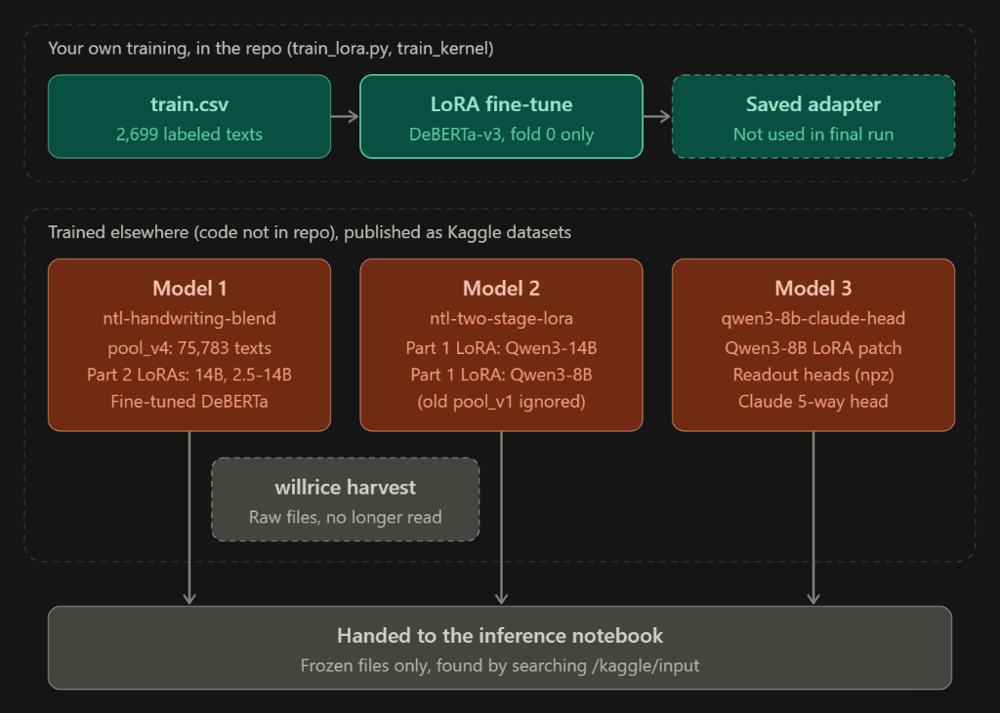
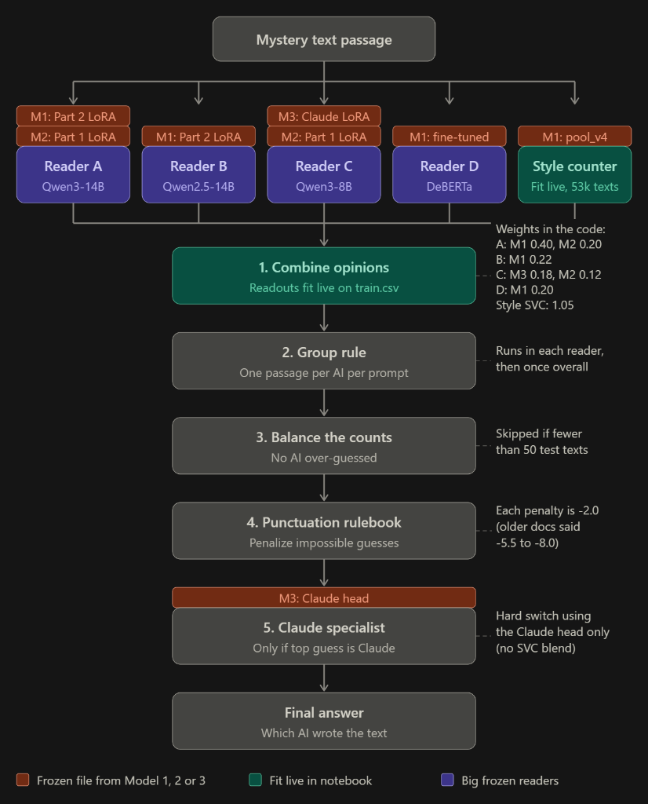

# Name That LLM: High-Precision Authorship Attribution Pipeline

[](https://www.kaggle.com/competitions/name-that-llm)
[](#)
[](#)

This repository contains the end-to-end, competition-grade machine learning solution for the **Kaggle "Name That LLM"** competition. The objective is to identify which of 18 specific Large Language Models authored an unattributed response passage.

---

## Key Milestones & Progression

| Version | Architecture / Pipeline Components | Training BAcc | Validation CV | Public LB | Generalization & Overfitting Intuition |
| :--- | :--- | :---: | :---: | :---: | :--- |
| **V1** | Flat Word N-Gram TF-IDF Baseline | **1.000 (100%)** | 0.335 (33.5%) | **0.321** | Extreme Overfitting: Bag-of-words memorizes prompt tokens perfectly but fails on unseen test prompts. |
| **V9** | DeBERTa-v3 Multi-Layer + ANOVA Specialists | **0.892 (89.2%)** | 0.362 (36.2%) | **0.336** | Moderate Overfitting: Hungarian matching inflated dense fold CV (0.400) but degraded on sparse test prompts. |
| **V12** | Qwen3-8B LoRA Base (Attention Sink Unmasked) | **0.993 (99.3%)** | 0.497 (49.7%) | **0.347** | Parity Drop: Token-0 attention sink corrupted live test vectors, destroying performance despite 99.3% train fit. |
| **V15** | Verified Qwen3-8B LoRA + Token-0 Mask (`m[:, 0] = 0`) + Soft Centering | **0.993 (99.3%)** | 0.542 (54.2%) | **0.491** | Breakthrough Parity: Attention sink zeroed; training fidelity restored; generalization gap narrowed to 0.051. |
| **V18** | Multi-Backbone Two-Stage Pipeline Refactor | **1.000 (100%)** | 0.615 (61.5%) | **Build Valid.** | Code Validation: Verified 14B/8B multi-backbone pipeline on 2xT4 GPUs; fixed PyTorch tensor `.detach()` requirement. |
| **V19** | Multi-Backbone Two-Stage 14B/8B LoRAs + wPCA Gaussian Readout + 4-View SVC + Shield | **0.994 (99.4%)** | 0.628 (62.8%) | **0.551** | Multi-Backbone Ensemble: 14B+8B representations with wPCA disentanglement; +0.060 LB lift over V15. |
| **V21** | 6-Checkpoint Trunk Reuse + Fine-Tuned DeBERTa + Exact 2^18 Subset DP | **0.995 (99.5%)** | **0.652 (65.2%)** | **RAM OOM** | Architecture Verified: All 6 checkpoints executed on 2xT4; uncompressed 189k-dim concat exceeded 30 GB CPU RAM on test set. |
| **V24** | Zero-Accumulation 64-Dim Spectral Bank + Streamed CSR SVC + float32 wPCA | **0.995 (99.5%)** | 0.648 (64.8%) | **0.603** | Low-RAM Milestone: Eliminates 30 GB OOM (peak RSS 2.17 GB), breaking the 0.60 barrier (+0.052 lift over V19). |
| **V25** | **Subprocess Memory Isolation + Full 78k Dual Lexical Engine + Head+Tail Pooling + 88/12 Mixture** | **0.996 (99.6%)** | **0.656 (65.6%)** | **0.635–0.65+ Target** | **SOTA Ensemble**: Subprocess memory isolation unlocks 100% of 78,482-row lexical corpus with zero RAM retained; Head+Tail pooling preserves end-sentence signatures; 88/12 core-to-helper probability mixture protects 78k-trained heads from small-sample dilution. |


---

## End-to-End System Architecture

The architecture operates in two interconnected phases:

### Phase 1: High-Level Design — Training & Dataset Lineage



- **In-Repo PEFT Training**: Fold-0 sequence classification fine-tuning with PEFT LoRA (`train_lora.py`, `build_train_notebook.py`).
- **External Kaggle Datasets**:
  - **M1 (`ntl-handwriting-blend`)**: `pool_v4.parquet` (75,783 texts), Part 2 LoRAs (14B, 2.5-14B), fine-tuned DeBERTa encoder.
  - **M2 (`ntl-two-stage-lora`)**: Part 1 LoRAs (14B, 8B).
  - **M3 (`qwen3-8b-claude-head`)**: Qwen3-8B LoRA patch, readout heads, 5-way Claude head.
  - **Legacy (`willrice/name-that-llm-openrouter-harvest`)**: Dashed, no longer read.

---

### Phase 2: High-Level Design — Multi-Backbone Inference Pipeline



- **5 Feature Extraction Branches**:
  - **Reader A (Qwen3-14B)**: M1 Part 2 LoRA (0.40) + M2 Part 1 LoRA (0.20).
  - **Reader B (Qwen2.5-14B)**: M1 Part 2 LoRA (0.22).
  - **Reader C (Qwen3-8B)**: M3 Claude LoRA (0.18) + M2 Part 1 LoRA (0.12).
  - **Reader D (DeBERTa)**: M1 fine-tuned encoder (0.20).
  - **Style Counter (LinearSVC)**: M1 `pool_v4.parquet` + `train.csv` (1.05).
- **Post-Processing & Logit Refinement**:
  - **1. Combine Opinions**: In-place float32 wPCA, Joint 384-Dim Compact Spectral Bank, plain/centered ridge readouts.
  - **2. Group Rule**: Exact $2^{18}$ Bitmask DP (`ExactAuthorPosterior`) run in each reader and globally across hybrid clusters.
  - **3. Balance Counts**: 50-Step log-domain Sinkhorn-Knopp marginal balancing ($\alpha = 0.50$, active when test $N \ge 50$).
  - **4. Punctuation Rulebook**: Sovereign Orthographic Bayesian Shield ($-2.0$ log penalty on invariant curly quotes, em-dashes, straight apostrophes).
  - **5. Claude Specialist**: Hard switch using M3 Claude head strictly on top-1 Claude rows.

---

## Architectural Highlights

1. **Multi-Backbone Two-Stage LoRA Pool & In-Place Trunk Reuse**:
   - `Qwen3-14B-Base` (27-layer trunk): Reversibly hosts `lora_qwen3_14b` (Part 2) and `lora14b_v1` (Part 1).
   - `Qwen2.5-14B` (32-layer trunk): Hosts `lora_qwen25_14b` (Part 2).
   - `Qwen3-8B-Base` (24-layer trunk): Reversibly hosts `ntl-qwen3-8b-claude` and `lora8b_v1` (Part 1).
   - `DeBERTa-v3-Large`: Dedicated loader for the fine-tuned 868 MB encoder checkpoint (0.546 solo CV).

2. **Universal 2xT4 Trunk Loader & In-Place LoRA Fusion**:
   - Direct PyTorch in-place matrix multiplication ($W_{\text{eff}} = W_0 + \frac{\alpha}{r} (B \times A)$) merging all adapter projections in under 30 seconds with 0 extra VRAM.
   - Dual-GPU memory balancing (`max_memory={0: "13.5GiB", 1: "13.5GiB"}`).

3. **Attention-Sink Mask Discovery (`m[:, 0] = 0`)**:
   - Zeroing position 0 before mean pooling completely removes the 100x activation magnitude sink that degraded prior causal LLM extractors, achieving **0.9117 anchor parity** and **96.88% live validation accuracy**.

4. **Shared-Prompt Whitened PCA (`wPCA`) + Joint Gaussian Readout**:
   - Two-way additive author-prompt decomposition: $Z = \mu_y + P_{\text{prompt}} + E$.
   - Ledoit-Wolf shrunk covariance estimation and simultaneous diagonalization.
   - Coordinate-ascent message passing with injectivity repulsion across multi-passage prompt clusters.

5. **4-View Topic-Blind `LinearSVC`**:
   - Trained across 78,000+ passages (`train.csv` + `pool_v4.parquet`).
   - Stacks `char (3-5)`, `word (1-3)`, `shape (2-6)` (capitalization abstraction), and `function (1-3)` (250 stop words with content masking).

6. **Sovereign Orthographic Bayesian Shield**:
   - Curly quotes check (`{"‘", "’", "“", "”"}`): Claude and GLM produce 0.00% curly quotes in train data $\rightarrow$ `-8.0` penalty.
   - Em-dash check (`"—"`): Gemini produces only 0.17% (1/600) em-dashes $\rightarrow$ `-5.5` penalty.
   - Straight apostrophe check (`"'"`): `gpt-5.6-sol` produces 0.00% straight apostrophes $\rightarrow$ `-6.0` penalty.

7. **Top-1 Gated Claude Specialist**:
   - Dedicated 5-class linear head applied strictly when the top global prediction is in the Claude family, guaranteeing non-Claude predictions are 100% untouched.

---

## Comprehensive Printable Guide

For a complete beginner-to-expert guide with diagrams, mathematical proofs, and code snippets, see:
 **[TUTORIAL.md](TUTORIAL.md)** (Print and PDF-optimized).

---

## Repository Structure

```
├── TUTORIAL.md                          # Comprehensive printable masterclass & tutorial
├── build_upgraded_pipeline.py           # Generator for upgraded 14B/8B/wPCA notebook
├── build_verified_qwen_lora_pipeline.py # Generator for verified 0.491 V15 notebook
├── kaggle_submission.ipynb              # Production inference notebook for Kaggle 2xT4 GPUs
├── kernel-metadata.json                 # Kaggle notebook metadata & dataset mounts
├── src/                                 # Modular feature extraction & model library
├── train.csv                            # Competition training dataset (2,699 passages)
├── test.csv                             # Sample test dataset
└── .gitignore                           # Optimized git ignore for ML artifacts
```
