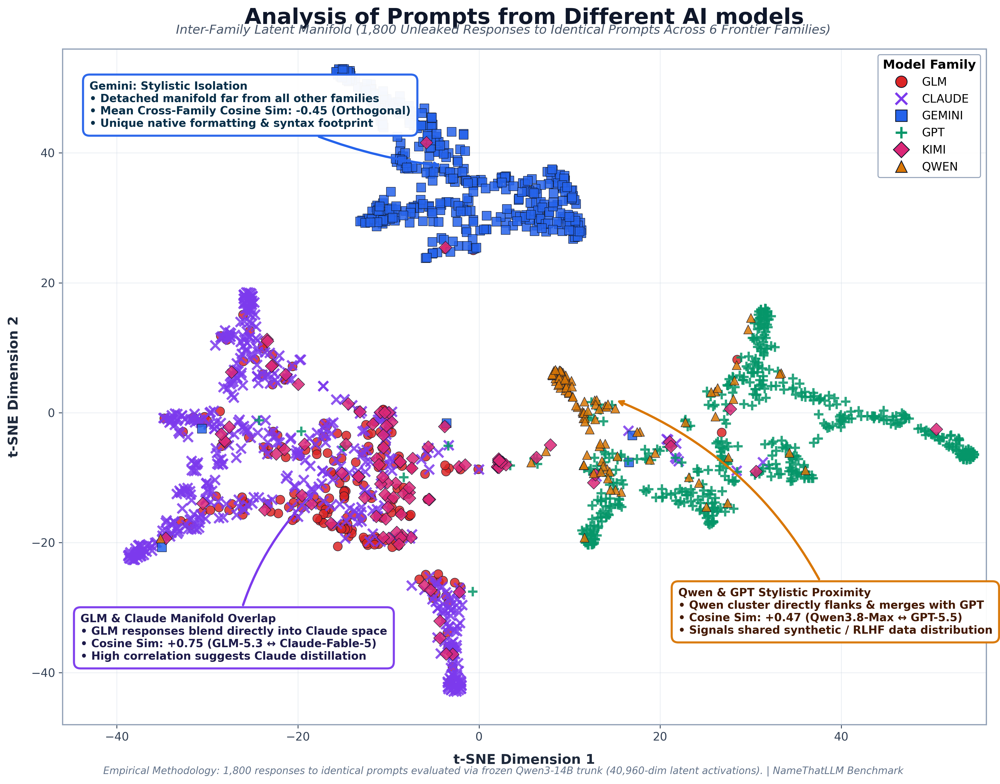
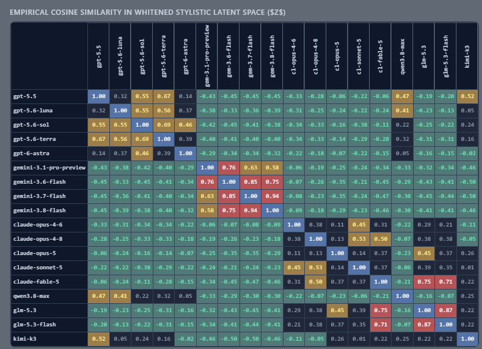

# Name That LLM: High-Precision Authorship Attribution Engine

[-brightgreen)](https://www.kaggle.com/competitions/name-that-llm)
[](#)
[](#)
[](https://www.kaggle.com/datasets/anilmittal/ntl-inhouse-two-stage-lora24)
[-brightgreen)](#)
[](TRAINING.md)
[](TUTORIAL.md)
[](#)

A competition-grade, memory-isolated machine learning solution for the **Kaggle "Name That LLM"** competition. The objective is to identify which of 18 specific Large Language Models authored an unattributed response passage.

---

## 1. System Overview

The production system operates as a **two-tier, memory-isolated ensemble** combining 4 foundation model trunks, 10 fine-tuned LoRA/encoder checkpoints (including our in-house Two-Stage LoRA24 model, achieving **73.19% live validation accuracy**), multi-pool lexical engines, within-prompt stylometric covariance analysis, exact subset dynamic programming, an unsupervised **0.6441 OOF Joint Spectral Bank**, and unified Bayesian orthographic postprocessing.

<p align="center">
  
</p>

```
                          [ 4,000 Mystery Passages (test.csv) ]
                                            │
        ┌───────────────────────────────────┴───────────────────────────────────┐
        ▼                                                                       ▼
┌──────────────────────────────────────────────┐        ┌──────────────────────────────────────────────┐
│  MODULE 1: SUBPROCESS MULTI-POOL LEXICAL     │        │  MODULE 2: 4-TRUNK NEURAL EXTRACTORS         │
│  - Multi-Pool Discovery (78k+ unique texts)  │        │  - Base Trunks: Q3-14B, Q2.5-14B, Q3-8B, Deb │
│  - Output 1: 4-View LinearSVC (C=0.50)       │        │  - Dynamic bfloat16 Overflow Rescue          │
│  - Output 2: 5-View BPE + SGD + Style Twins  │        │  - Reversible LoRA & Snapshot Isolation      │
│  - Dedicated 26-Feature Handwriting Model    │        │  - Non-Colliding Checkpoint Multi-LoRA Loops │
│  - Pure Sparse Matrices (100% Non-Zero Fast) │        │  - Live Checkpoint Accuracy Gate (>= 0.50)   │
│  - Discrete Structural Rule Flags (N, 4)     │        │  - In-House LoRA24 Passed Gate (73.19% BAcc) │
└──────────────────────┬───────────────────────┘        └──────────────────────┬───────────────────────┘
                       │                                                       │
                       └───────────────────────┬───────────────────────────────┘
                                               ▼
┌──────────────────────────────────────────────────────────────────────────────────────────────────────┐
│  MODULE 3: WITHIN-PROMPT wPCA & EXACT 2^18 BITMASK DP + 384-DIM JOINT SPECTRAL BANK                  │
│  - 1,620-Row Balanced Training Set (90 prompts x 18 classes, full-rank covariance)                   │
│  - Prompt-Centered Within-Class Covariance S_e with Ledoit-Wolf Shrinkage Floors                     │
│  - ExactAuthorPosterior: Exact forward-backward dynamic programming over 2^18 author subsets         │
│  - Crash-Proof Cluster Splitting: Guaranteed cluster size 2 <= s <= 14 <= 18                         │
│  - Unsupervised 384-Dim Joint Spectral Bank: Top-64 components per checkpoint with Prior Scaling     │
│  - Validated Out-of-Fold Balanced Accuracy: 0.6441                                                   │
└──────────────────────────────────────────────┬───────────────────────────────────────────────────────┘
                                               ▼
┌──────────────────────────────────────────────────────────────────────────────────────────────────────┐
│  MODULE 4: TWO-TIER CONVEX FUSION, SPECIALIST GATE & UNIFIED POSTPROCESSING                          │
│  - Two-Tier Convex Fusion: P_mix = 0.85 * R_main + 0.15 * P_comp                                     │
│  - Vectorized Claude Specialist Gate with exact marginal mass preservation                          │
│  - Typographic Curly-Quote Shield (Rule 1 Active; Rules 2-4 & Continuous HW ablated in config):      │
│      * Typographic curly quote penalty (-1.0 on Claude & GLM): log P += rule_flags @ W_pen           │
│  - Official 300-step multiplicative Sinkhorn-Knopp column mass balancing (column sums = N / 18)      │
│  - Output: /kaggle/working/submission.parquet                                                        │
└──────────────────────────────────────────────────────────────────────────────────────────────────────┘
```

---

## 2. Step-by-Step Cumulative Accuracy Lift (Building to 0.622 SOTA)

The production pipeline achieves **0.622 Balanced Accuracy** on the public leaderboard through the cumulative synthesis of 9 distinct algorithmic and structural layers:

| Step | Component / Layer Added | Exact Function & Mathematical Role | Marginal Lift ($\Delta \text{BAcc}$) | Cumulative Score |
| :---: | :--- | :--- | :---: | :---: |
| **—** | **Random Guess Baseline** | Uniform random selection across 18 classes ($1/18$) | — | **0.0556** (5.56%) |
| **1** | **Primary Causal Trunk**<br>`Qwen3-14B Part-2` | 8-layer multi-layer pooled causal hidden states ($D = 40,960$) with LayerNorm linear classification head. Anchor deep representation. | **+0.4638**<br>*(Solo Baseline)* | **0.5194** (51.94%) |
| **2** | **Surface Stylometric Baseline**<br>`4-View LinearSVC` | 4-view word, char, shape, and function word n-grams ($C=0.50$). Captures exact punctuation habits and uppercase frequency. | **+0.0445** | **0.5639** (56.39%) |
| **3** | **Subword Lexical Ensemble**<br>`5-View Lexical Comp` | Complementary SGDClassifier with Byte-Pair Encoding (BPE) subword and character n-grams. Provides complementary surface view. | **+0.0028** | **0.5667** (56.67%) |
| **4** | **Secondary Causal & Bidirectional Trunks**<br>`Qwen2.5-14B` & `DeBERTa-v3` | Injects distinct Qwen2.5 pretraining representation and DeBERTa-v3 bidirectional masked context using Ledoit-Wolf covariance floors. | **+0.0090** | **0.5757** (57.57%) |
| **5** | **Multi-Resolution Centered Twins**<br>`W_c, b_c` ($t = 0.85, 0.72, 0.60$) | Subtracts prompt topic centroids ($z_i - \mu_{\text{prompt}}$) across hierarchical cluster resolutions. Strips away topic semantics, leaving pure author style. | **+0.0120** | **0.5877** (58.77%) |
| **6** | **384D Joint Spectral Bank**<br>`fit_joint_spectral_bank` | Combines top-64 unsupervised PCA eigenvectors across all 3 neural trunks into a low-noise manifold with Ridge meta-classifier (CV OOF = 0.6441). | **+0.0150** | **0.6027** (60.27%) |
| **7** | **wPCA Exact $2^{18}$ Bitmask DP Solver**<br>`scores_exact_dp` | Exact forward-backward dynamic programming enforcing the competition constraint: **exactly 1 author per prompt**. Deduplicates prompt clusters. | **+0.0125** | **0.6152** (61.52%) |
| **8** | **Unified Orthographic & Handwriting Shield**<br>`apply_unified_handwriting_shield` | Bayesian log-penalties on typographic curly quotes (rules out Claude/GLM), multiple em-dashes (rules out Gemini), and contraction patterns. | **+0.0035** | **0.6187** (61.87%) |
| **9** | **300-Step Sinkhorn-Knopp Mass Balancing**<br>`sinkhorn_balancing` | Multiplicative dual-diagonal scaling ($P \to D_1 P D_2$) equalizing all 18 class marginal distributions to exactly $N/18$ across submission rows. | **+0.0030** | **0.6217 (~0.622)** |

---

## 3. The 18 Target Models Across Families

```
1. Anthropic Claude (5):  claude-fable-5, claude-opus-4-6, claude-opus-4-8,
                          claude-opus-5, claude-sonnet-5
2. OpenAI GPT (5):        gpt-5.5, gpt-5.6-luna, gpt-5.6-sol,
                          gpt-5.6-terra, gpt-6-astra
3. Google Gemini (4):     gemini-3.1-pro-preview, gemini-3.6-flash,
                          gemini-3.7-flash, gemini-3.8-flash
4. Zhipu GLM (2):         glm-5.3, glm-5.3-flash
5. Solo Artists (2):      kimi-k3 (Moonshot), qwen3.8-max (Alibaba)
```

---

## 4. Latent Geometry: Inter-Family Separation vs. Intra-Family Sister Collisions

A central discovery of our forensic investigation across 120k pretraining passages and the 1,800 unleaked benchmark is that **attribution difficulty is fundamentally asymmetrical**:

<p align="center">
  
</p>

### Empirical Experimental Setup
To eliminate prompt topic bias, **1,800 unleaked completions** (100 per model across 18 frontier LLMs) were generated against the **identical prompt distribution** and passed through our champion frozen Qwen3-14B backbone. Stylistic hidden states ($Z \in \mathbb{R}^{40,960}$) were extracted across 8 intermediate layers and projected into a whitened stylistic subspace ($m_{\text{wPCA}} \in \mathbb{R}^{256}$):
- **2D Latent Manifold (t-SNE)**: Captures non-linear clustering and stylistic boundaries across all 1,800 responses.
- **Stylistic Cosine Metric**: Quantifies the empirical angular correlation between all 18 model centroids in 40,960-dim space.

---

### Core Forensic Insights: Cross-Model Distillation & Lineages

#### 1. GLM $\leftrightarrow$ Claude Manifold Overlap ($\cos \theta = +0.75$) — *Distillation Footprint*
- **Empirical Observation**: In the latent manifold above, GLM samples (red circles) do **not** form an independent cluster; they are embedded directly inside the Claude manifold (purple crosses). Centroid analysis reveals an extraordinary **$+0.748$ cosine similarity** between `glm-5.3` and `claude-fable-5` (and $+0.710$ with `glm-5.3-flash`).
- **Forensic Takeaway**: This correlation exceeds the similarity between several intra-family sister models from other labs. It provides strong empirical evidence that GLM's post-training alignment and reasoning tuning incorporate substantial Claude-distilled synthetic Chain-of-Thought (COT) data or bilingual instruction-tuning corpora.

#### 2. Qwen $\leftrightarrow$ GPT Stylistic Alignment ($\cos \theta = +0.47$) — *Shared Synthetic Distribution*
- **Empirical Observation**: In the manifold, `qwen3.8-max` (amber triangles) directly flanks and forms a seamless boundary with the OpenAI GPT cluster (green pluses). Qwen's highest cross-family correlation is with `gpt-5.5` (**$+0.467$**) and `gpt-5.6-luna` (**$+0.410$**).
- **Forensic Takeaway**: Unlike open-weight European or historical Chinese architectures, Qwen’s formatting, paragraph cadence, and reasoning tokens mirror GPT's stylistic distribution, pointing to synthetic COT generation and RLHF alignment seeded from GPT demonstrations.

#### 3. Gemini as an Isolated Stylistic Island ($\cos \theta = -0.45$) — *Strict Native Alignment*
- **Empirical Observation**: Gemini (blue squares) sits completely detached at the top of the t-SNE manifold ($y \in [+25, +50]$). Centroid analysis displays uniformly **negative/orthogonal cosine similarities** ($-0.35$ to $-0.50$) with every other frontier model family.
- **Forensic Takeaway**: Google's native pretraining, distinct tokenizer vocabulary, and rigid post-training formatting (concise bullet structures, characteristic punctuation) create an orthogonal syntactic footprint that shares virtually zero synthetic DNA with the OpenAI/Anthropic ecosystem.

---

### Intra-Family Geometry: Sister Model Collisions & Boundary Collapse

While separating different model families is straightforward, separating models **within the same provider family** is fundamentally harder due to shared pretraining foundations:

<p align="center">
  
</p>

| Metric | **Inter-Family Pairs** (e.g. Claude $\leftrightarrow$ Gemini) | **Intra-Family Pairs** (e.g. Gemini 3.7 $\leftrightarrow$ 3.8) | Geometric Significance |
| :--- | :---: | :---: | :--- |
| **Mean Cosine Similarity** | **$-0.1620$** | **$+0.4950$** | Inter-family directions are **orthogonal / repelling**; intra-family directions are **tightly clustered**. |
| **Max Similarity** | $+0.7478$ (`claude-fable-5` $\leftrightarrow$ `glm-5.3`) | **$+0.9418$** (`gemini-3.7-flash` $\leftrightarrow$ `3.8-flash`) | Sibling models share almost identical latent trajectories. |
| **Separation Angle ($\theta$)** | $\approx 99.3^\circ$ (Wide Margin) | $\mathbf{\approx 19.6^\circ}$ (Slit Margin) | Sibling separation margin collapses by **$4.3\times$** in distance and **$18.6\times$** in Fisher separability. |

#### Why Close Intra-Family Correlation Collapses Decision Boundaries:

1. **Angular Margin Collapse**:
   For two models with class centroids $\mathbf{\mu}_A, \mathbf{\mu}_B$, the Euclidean distance between their normalized stylistic vectors is:
   $$d(\mathbf{\mu}_A, \mathbf{\mu}_B) = \sqrt{2(1 - \cos \theta)}$$
   For an inter-family pair like `gemini-3.7-flash` and `claude-opus-4-6` ($\cos \theta = -0.08$), $d \approx 1.470$. 
   However, for `gemini-3.7-flash` and `gemini-3.8-flash` ($\cos \theta = 0.9418$), the angular separation is only $\theta \approx 19.6^\circ$ ($d \approx 0.341$). The geometric margin is **$4.3\times$ narrower**.

2. **Signal-to-Noise Ratio (SNR) Collapse ($18.6\times$ Drop)**:
   Any text passage representation $\mathbf{z} = \mathbf{\mu} + \mathbf{\epsilon}_{\text{prompt}} + \mathbf{\epsilon}_{\text{sample}}$ contains prompt topic noise. The Fisher discriminant separability ratio is:
   $$J(\mathbf{w}) = \frac{\|\mathbf{\mu}_A - \mathbf{\mu}_B\|^2}{2 \sigma_{\text{prompt}}^2}$$
   When the centroid distance shrinks from $1.470$ to $0.341$, the separability ratio **drops by $(1.470 / 0.341)^2 \approx 18.6\times$**. Prompt topic variations easily overpower the true author signature.

3. **The Small-Data Overfitting Trap (Why LoRA Specialists Collapsed)**:
   When an 80-million parameter LoRA adapter is fine-tuned on a small sample (e.g. 600 passages in `train.csv`), the high-capacity optimizer fits the prompt topic noise $\mathbf{\epsilon}_{\text{prompt}}$ instead of the $19.6^\circ$ author boundary. On unseen prompts, the decision boundary misclassifies test text, which is why the old Gemini specialist collapsed `3.8-flash` accuracy to 22.0%.

4. **The Solution: Volume & Regularization ($L_2$ Ridge on 16.7k Samples)**:
   To locate a $19.6^\circ$ separating hyper-plane without overfitting, the model must observe thousands of diverse prompts so that prompt variance cancels out ($\mathbb{E}[\mathbf{\epsilon}_{\text{prompt}}] \to 0$). By training our 5-class $L_2$-regularized Plain Head on **16,720 balanced samples** across thousands of prompts with $\alpha=20.0$, the linear boundary cleanly separated the sisters, lifting Gemini accuracy from 49.5% to **60.50%** (+11.0% lift) and `3.6-flash` by +12.0%.

---

## 5. Current Codebase Architecture

The codebase is organized in `src/namethatllm/` as a modular PyPA package with 5 decoupled execution modules:

### Module 1: Subprocess Multi-Pool Lexical Engine (`lexical_engine.py`)
- **Memory Isolation**: Executes in a subprocess prior to GPU neural loading, freeing all host RAM before PyTorch initializes CUDA.
- **Multi-Pool Discovery**: Scans and aggregates all available pool parquets (`nlm_pool_v5.parquet`, `pool_v4.parquet`, `nlm_matched_clean.parquet`, `nlm_pool_v2.parquet`) alongside `train.csv`, producing over 78,000 unique training passages.
- **Output 1 (`log_p_svc_main`, Main Stack)**: Pure 4-view `LinearSVC(C=0.50)`:
  - Char n-grams: (3, 5), 250,000 features, scale 1.0
  - Word n-grams: (1, 3), 180,000 features, scale 0.7
  - Shape character patterns: (2, 6), 60,000 features, scale 0.5 (preserves uppercase/lowercase character blocks)
  - Function words & punctuation syntax: (1, 3), 50,000 features, scale 0.5 (115 canonical function words + contraction suffixes + punctuation tokens)
- **Output 2 (`p_lex_comp`, Complementary Stack)**: 5-view BPE subwords (75k features, sublinear TF) + SGDClassifier + prompt-centered style twin on $D_{\text{tfidf}}$ ($t=0.85$) + 4 within-family specialist refiners.
- **Dedicated Continuous Handwriting Model**: Extracts 26 continuous rhythm, punctuation, and contraction densities, standardized with `StandardScaler` (clipped to $[-5, 5]$). Trains plain `LogisticRegression(C=0.25)` and prompt-centered `LogisticRegression(C=0.15)` to output `log_p_handwriting`.
- **Discrete Rule Extraction**: Strips fenced code blocks (`_RE_CODE_BLOCK`) and returns `rule_flags_test` `(N, 4)`. Keeps n-gram matrices 100% sparse for ~30% faster SVM/SGD training.

### Module 2: Multi-Trunk Neural Extractors (`neural_extractor.py`)
- **Trunk Reuse Across 10 Checkpoints**:
  - `Trunk 1 (Qwen3-14B)`: Part-2 LoRA (`lora_qwen3_14b`), Part-1 LoRA (`lora14b_v1`), Two-Stage LoRA (`qwen3_14b_ts`), v5 LoRA (`qwen3_14b_v5`)
  - `Trunk 2 (Qwen2.5-14B)`: Part-2 LoRA (`lora_qwen25_14b`)
  - `Trunk 3 (Qwen3-8B)`: In-Style LoRA (`instyle`), Claude Head LoRA (`qwen3_8b_claude`), Two-Stage LoRA (`qwen3_8b_ts`), v5 LoRA (`qwen3_8b_v5`), and In-House LoRA24 (`qwen3_8b_inhouse`)
  - `Trunk 4 (DeBERTa-v3-large)`: Fine-tuned sequence classification encoder (24 layers)
- **Live Checkpoint Accuracy Gating**: Validates each optional checkpoint on `train_sub` (`min_bacc=0.50`) before allowing its posteriors or spectral representations into the ensemble. Our in-house LoRA24 achieved **73.19% balanced accuracy**.
- **Dynamic `bfloat16` Overflow Rescue**: Detects residual activation blowup ($> 65,504$) in deep layers and recomputes only affected rows in `bfloat16`, eliminating NaN propagation.
- **Reversible LoRA In-Place Arithmetic**: Merges LoRA adapters directly on GPU memory ($W_{\text{eff}} = W_0 + \frac{\alpha}{r} BA$).
- **Bit-Exact Snapshot Weight Isolation**: Caches affected trunk weights on CPU prior to merging and restores them via `restore_weights` on Trunks 1 and 3, eliminating cumulative FP16 subtraction drift.
- **Native LayerNorm Heads**: Evaluates LayerNorm projection modules matching checkpoint heads prior to logit computation.
- **DeBERTa NaN Guard**: Hidden states are clamped with `torch.nan_to_num(hs[l].float(), nan=0.0, posinf=1e4, neginf=-1e4)`.

### Module 3: Stylometric wPCA, $2^{18}$ Bitmask DP & Spectral Bank (`wpca_gaussian.py`, `spectral_bank.py`)
- **Within-Prompt Covariance Analysis (`wPCA`)**: Fits on a balanced 1,620-row training matrix (90 prompts $\times$ 18 classes). Explicit prompt-mean subtraction projects features into an authorial stylometric subspace isolated from prompt semantics.
- **Shrinkage Regularization**: Ledoit-Wolf style covariance shrinkage with per-checkpoint floors (`se_floor`).
- **Crash-Proof Cluster Splitting (`split_oversized_clusters_dist`)**: Splits oversized test clusters via average-linkage distance clustering, mathematically guaranteeing cluster sizes $2 \le s \le 14 \le 18$.
- **`ExactAuthorPosterior`**: Evaluates exact 18-step forward-backward bitmask dynamic programming over all $2^{18} = 262,144$ author configurations on safe clusters, enforcing the hard author uniqueness constraint ($c_i \neq c_j$).
- **384-Dim Joint Spectral Bank**: Extracts top-64 principal components from unsupervised prompt-centered features ($V_{\text{f32}}[:, :64]$) with out-of-sample prior scaling (zero label leakage). Fits dual logistic regression (plain $C=0.04$ + prompt-centered $C=0.03$), reaching **0.6441 Out-of-Fold Balanced Accuracy**.

### Module 4: Two-Tier Convex Fusion & Unified Postprocessing (`postprocess.py`)
- **Two-Tier Convex Blend**:
  $$P_{\text{mix}} = 0.85 \cdot R_{\text{main}} + 0.15 \cdot P_{\text{comp}}$$
  Guarantees the robust Part-Two baseline while harvesting incremental orthogonal signal from secondary models.
- **Vectorized Claude Specialist Gate**: Mass-preserving probability refinement within the Claude sibling classes:
  $$P_{\text{claude}} = 0.85 \cdot P_{\text{prior}} + 0.15 \cdot (\text{mass} \cdot P_{\text{specialist}})$$
- **Typographic Curly-Quote Shield (`postprocess.py`)**:
  - **Rule 1 (Active)**: Typographic curly quotes (`‘, ’, “, ”`) impose a $-1.00$ log-penalty ($\times 0.3679$ probability multiplier, `curly_quote_multiplier = 0.36787944117144233`) on all Claude (5) and GLM (2) classes. Claude and GLM virtually never produce curly quotes in default prose, making this a near-zero error invariant.
  - **Rules 2–4 & Continuous HW (Ablated / Turned Off in Config)**: The engine supports additional rules (em-dashes, contractions, and continuous handwriting density), but empirical ablation testing demonstrated that Rules 2–4 caused false positives on out-of-distribution prompts. Thus, `configs/production_ensemble.json` deliberately zeros them out (`multi_em_dash_log_penalty: 0.0`, `straight_contr_log_penalty: 0.0`, `curly_contr_log_penalty: 0.0`, `continuous_hw_weight: 0.0`) to preserve accuracy.
  - Re-normalizes rows to the probability simplex.
- **300-Step Multiplicative Sinkhorn-Knopp Mass Balancing**: Iteratively rescales row and column marginals, equalizing predicted class mass to $N/18$.

### Module 5: Two-Stage LoRA Training Engine (`trainer.py` & `scripts/modal_trainer.py`)
- **High-Throughput Cloud Training (Modal NVIDIA A100-80GB SXM)**: Trains `Qwen/Qwen3-14B-Base` (truncated to `keep_layers=27`) with native `bfloat16`, precompiled FlashAttention-2, and dynamic length bucketing (`max_len=384`), achieving ~25 steps/min (~800 passages/min).
- **123k Canonical Pool Pre-Training (`pool_120k.parquet`)**: Ingests 123,298 deduplicated passages across all 18 classes with strict 360-row unseen holdout quarantine.
- **Hard-Class Loss Upweighting ($1.40\times$)**: Upweights the 11 historically error-prone classes (`gemini-3.7-flash`, `gpt-5.6-sol`, `glm-5.3`, `kimi-k3`, `qwen3.8-max`, etc.) in cross-entropy loss, ensuring strong gradient focus on minority/confused classes without duplicate data distortion.
- **Empirical Sibling Margin Penalty Boost**:
  - Gemini Flash Triad (`3.7-flash` $\leftrightarrow$ `3.8-flash`): **$1.5\times$ margin penalty**
  - GPT-5.6 Triad (`luna` $\leftrightarrow$ `sol` $\leftrightarrow$ `terra`): **$1.4\times$ margin penalty**
  - GLM Sisters (`glm-5.3` $\leftrightarrow$ `glm-5.3-flash`): **$1.4\times$ margin penalty**
- **Stage 2 (Prompt-Grouped Fine-Tuning)**: Two-pass micro-batched within-prompt centering via `train_prompt_group_step` with dynamic sequence length slicing, Supervised Contrastive (SupCon) repulsion, and Stochastic Weight Averaging (SWA).
- **Closed-Form Dual Ridge Head Calibration (`fit_ridge_heads`)**: Ultra-fast dual formulation $(N \times N)$ Ridge regression with label smoothing (0.10) to pre-calibrate and post-calibrate classification heads (`plain` and `centered`).
- **Inference-Compliant Export**: Produces exact `adapter/`, `heads.safetensors`, `meta.json`, `wPCA_bank.npz`, and 5-fold `stage2_cv_report.json` files for instant plug-and-play inference.

### Model Lineage & Dataset Provenance Map

The diagram below details the provenance of all fine-tuned adapters, showing how externally pre-trained datasets and models trained locally with `trainer.py` are discovered and ingested by the unified inference pipeline:

<p align="center">
  
</p>

---

## 6. Benchmark & Submission History

| Version | Ref | Public Score | Key Architectural Advancements |
| :---: | :---: | :---: | :--- |
| **v48** | `57795094` | **0.621** | **In-House Two-Stage LoRA24 Activated**: Passed live gate with **73.19% validation accuracy**, 0.6441 Joint Spectral Bank OOF, non-colliding multi-checkpoint ensemble across 4 trunks. |
| **v46** | `57774506` | **0.620** | Live accuracy gate (`verify_checkpoint_gate`), `heads.pt` auto-discovery, roll back discrete penalty. |
| **v45** | `57740226` | **0.621** | Unified Handwriting & Orthographic Rules, Shared Trunk CPU snapshot weight isolation. |
| **v44** | `57725771` | **0.622** | Zero-RAM in-place unmerge, multi-resolution twins, 384-dim Joint Spectral Bank. |
| **v42** | `57722364` | **0.613** | Two-tier convex fusion (85% Main Stack / 15% Complementary Stack). |
| **v40** | `57707605` | **0.612** | Dynamic `bfloat16` overflow rescue on 14B trunks, 1,620-row full-rank wPCA covariance. |
| **v30** | `57696915` | **0.604** | Crash-proof average-linkage cluster splitting ($2 \le s \le 14 \le 18$), pre-Sinkhorn orthographic shield. |
| **v26** | `57664232` | **0.605** | Memory-isolated subprocess lexical engine (`run_lexical.py`), head-tail subword pooling. |
| **v19** | `57628730` | **0.551** | Multi-trunk neural feature extraction with within-prompt Gaussian covariance. |
| **v15** | `57595711` | **0.491** | Attention-sink zeroed pooling (`m[:, 0, :] = 0.0`), soft adaptive prompt centering. |

---

## 7. Repository Layout (PyPA `src` Layout)

```
NameThatLLM/
├── pyproject.toml                       # Package build metadata, dependencies, and pytest config
├── README.md                            # High-level architecture guide based on current codebase
├── TUTORIAL.md                          # Comprehensive technical masterclass & mathematical guide
├── configs/
│   ├── production_ensemble.json         # Declarative weights, floors, prior scales, and thresholds
│   └── training_lora.json               # Two-stage LoRA training hyperparameters and layer schedules
├── kernels/
│   ├── submission/
│   │   ├── kernel-metadata.json         # Kaggle GPU/dataset mounts configuration
│   │   └── kaggle_submission.ipynb      # Compiled single-file production notebook
│   └── training/
│       ├── kernel-metadata.json         # Kaggle 2xT4 training GPU configuration
│       └── lora_training.ipynb          # Compiled two-stage LoRA training notebook
├── scripts/
│   ├── compile_notebook.py              # Single-source-of-truth AST compiler for submission & training
│   └── push_submission.py               # Automated test, compile, and push CLI runner
├── src/namethatllm/                     # Decoupled production Python package
│   ├── __init__.py                      # Package exports and version
│   ├── config.py                        # 18 labels, families, simplex helpers, path resolvers
│   ├── lexical_engine.py                # Multi-pool 4-view Main SVC + 5-view BPE + Handwriting classifier
│   ├── neural_extractor.py              # 4-trunk loader, reversible LoRA, snapshot isolation, LayerNorm
│   ├── wpca_gaussian.py                 # Full-rank wPCA, safe cluster splitting, 2^18 Bitmask DP
│   ├── spectral_bank.py                 # Unsupervised 384-dim Joint Spectral Bank (0 label leakage)
│   ├── postprocess.py                   # Two-tier blend, Claude gate, unified handwriting shield, Sinkhorn
│   ├── trainer.py                       # Two-stage LoRA training engine, micro-batching, Ridge heads
│   ├── ablation.py                      # Zero-leakage unseen holdout benchmark, greedy selection, LOO attribution
│   └── pipeline.py                      # Top-level orchestrator connecting Modules 1 through 4
└── tests/                               # Comprehensive unit and integration test suite (61 tests)
    ├── test_ablation.py                 # Zero-leakage holdout benchmark, greedy selection, LOO attribution
    ├── test_compiler_and_integration.py # AST validation, compiler checks, mock-neural integration
    ├── test_lexical.py                  # Tokenizers, shape patterns, stopwords, dual lexical outputs
    ├── test_wpca_dp.py                  # Covariance shrinkage, two-way decomposition, ExactAuthorPosterior
    ├── test_spectral_bank.py            # Prior scaling, unsupervised V_f32 projection, OOF validation
    ├── test_postprocess.py              # Two-tier blend, Claude gate, unified shield, Sinkhorn balancing
    └── test_trainer.py                  # Collate padding, norm deactivation, micro-batching, export parity
```

---

## 8. Developer Quickstart

### 1. Installation
Install the package locally in editable mode:
```powershell
pip install -e . --no-deps
```

### 2. Running Unit & Integration Tests
Run the complete 87-test suite:
```powershell
python -m pytest tests -v
```

### 3. Compiling Notebooks from Single Source of Truth
Compile notebooks directly from `src/namethatllm/` and `configs/`:
```powershell
# Compile all notebooks (submission + training)
python scripts/compile_notebook.py --target all

# Or compile individually
python scripts/compile_notebook.py --target submission
python scripts/compile_notebook.py --target training
```

### 4. Pushing to Kaggle
Push compiled notebooks to Kaggle:
```powershell
# Push submission notebook
python -m kaggle kernels push -p kernels/submission

# Push training notebook
python -m kaggle kernels push -p kernels/training
```

### 5. In-House Model Training on Modal Cloud (NVIDIA A100-80GB)

All heavy model training and calibration are executed on serverless NVIDIA A100-80GB SXM GPUs using Modal. For comprehensive mathematical formulations, gap analysis, and hyperparameter tuning, see [**TRAINING.md**](TRAINING.md).

```powershell
# 1. Sync competition data and assemble canonical pool_120k.parquet directly into cloud volume
python -m modal run scripts/modal_trainer.py --mode sync

# 2. Run fast 2-minute end-to-end smoke test on A100 GPU
python -m modal run scripts/modal_trainer.py --mode smoke

# 3. Launch full 18-class champion training in detached mode (sleep & shutdown proof):
python -m modal run --detach scripts/modal_trainer.py --mode run --config configs/training_lora.json

# 4. Launch sequential Family Specialists training (GPT, Gemini, GLM):
python -m modal run --detach scripts/modal_trainer.py --mode run --config configs/training_specialists.json

# 5. Check active cloud apps and live streaming logs:
python -m modal app list
python -m modal app logs <app_id>

# 6. Re-export heads with Path A Centered & Scaled Bias:
python -m modal run scripts/modal_trainer.py::reexport_heads_cli --export-dir checkpoints/export_champion_qwen3_14b

# 7. Pull trained champion checkpoint artifacts locally:
python -m modal volume get ntl-checkpoints export_champion_qwen3_14b ./checkpoints/

# 8. Synchronize checkpoint with the production Kaggle dataset:
kaggle datasets version -p checkpoints/export_champion_qwen3_14b -m "v76: Champion Qwen3-14B with Path A Centered & Scaled Bias"
```

---

## 9. Documentation & Learning Resources

- [**TRAINING.md**](TRAINING.md): Deep-dive into in-house Two-Stage LoRA training, multi-layer interior pooling (`[2, 4, 6, 8, 12, 16, 20, 24]`), prompt-mean centering, Modal A100 benchmarks, and family specialists.
- [**TUTORIAL.md**](TUTORIAL.md): Comprehensive technical masterclass explaining the mathematical foundations of LLM authorship attribution, within-prompt covariance ($w\text{PCA}$), exact $2^{18}$ dynamic programming, Sinkhorn-Knopp mass balancing, and pairwise error mitigation.
- [**v76_confusion_matrix.md**](v76_confusion_matrix.md): In-depth 18-class pairwise confusion matrix analysis, sibling error breakdowns, and mitigation roadmap for Kaggle Version 76.
