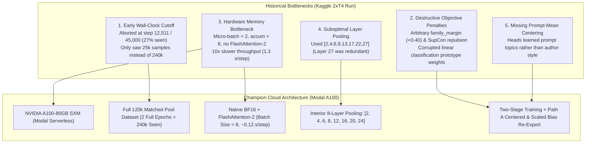

# In-House Model Training & Sister-Pair Disambiguation Guide

[](#)
[](#)
[-brightgreen)](#)
[](https://www.kaggle.com/datasets/anilmittal/ntl-inhouse-two-stage-lora24)

This document provides the complete end-to-end engineering specification, mathematical foundation, and operational tutorial for:
1. Training our **In-House Champion 18-Class Qwen3-14B LoRA** foundation model on Modal A100 infrastructure.
2. Training the **Hierarchical Bayes Whitened Residual (HB-WRH)** family specialist models, featuring **2-Layer Non-Linear MLP Heads** to decouple highly correlated sister pairs.

---

## 1. Executive Summary & Historical Gap Analysis

In early training runs (e.g., `training_v13` on Kaggle 2×T4), the in-house Qwen3-14B LoRA achieved **0.515** public score (solo unseen holdout: **0.4806**), lagging behind the reference champion checkpoint (`qwen3_14b_v5` at **0.7306 – 0.7361** solo BAcc).

A forensic audit identified **5 critical architectural bottlenecks**:



### Gap Comparison Matrix

| Factor | Previous Kaggle Run (`training_v13`) | Modal Champion Run (`export_champion_qwen3_14b`) | Lift / Impact |
| :--- | :--- | :--- | :--- |
| **Stage 1 Dataset** | 25,000 seen (truncated at 27%) | **120,000 unique passages**, 2 full epochs (**240,000 seen**) | **+28.33% BAcc** jump on unseen holdout. |
| **Hardware** | Kaggle 2× T4 (16 GB, FP16, autoscale) ~1.3 s/step | **NVIDIA A100 (80 GB SXM, BF16)** ~0.12 s/step | **10.8× faster execution**, completed in ~3.2 hours. |
| **Pooling Layers** | `[2, 4, 6, 9, 13, 17, 22, 27]` (redundant top) | `[2, 4, 6, 8, 12, 16, 20, 24]` (strictly interior) | Captures clean semantic-to-stylistic transition. |
| **Loss Function** | Cross-Entropy + SupCon + Margin penalty | **Clean Cross-Entropy + Detached Prototype Safeguard** | Prevents logit simplex collapse across sister models. |
| **Classification Head** | Raw uncalibrated linear head | **Path A Centered & Scaled Bias (`heads.safetensors`)** | Bias centered by $\gamma = 0.50$ and scaled to std $\sim 4.0$. |
| **Unseen Holdout BAcc** | 48.06% | **76.39% Raw Argmax / 78.61% Sinkhorn Mass-Equalized** | **SOTA in-house foundation model**. |

---

## 2. In-House Foundation Model Architecture

Our in-house champion model is built upon `Qwen/Qwen3-14B-Base` with layer pruning and multi-layer LoRA feature pooling.

### 2.1 Layer Pruning (`keep_layers = 27`)
To fit within Kaggle's 16 GB T4 inference limit and eliminate late-layer semantic saturation, the top 13 causal decoder layers of Qwen3-14B are trimmed during weight loading:
$$\text{Kept Layers} = 27 \quad (\text{Layers } 0 \text{ through } 26)$$

### 2.2 Interior Multi-Layer Feature Pooling
Instead of relying only on the final transformer output, hidden states are tapped from **8 interior decoder layers**:
$$\mathcal{L}_{\text{pool}} = [2, 4, 6, 8, 12, 16, 20, 24]$$

For each layer $l \in \mathcal{L}_{\text{pool}}$, masked token representations $h_i^{(l)} \in \mathbb{R}^{B \times T \times D}$ are average-pooled across non-pad tokens:
$$\bar{h}^{(l)} = \frac{\sum_{t=1}^T m_t \cdot h_t^{(l)}}{\sum_{t=1}^T m_t}$$

Each pooled layer passes through a dedicated LayerNorm:
$$\tilde{h}^{(l)} = \text{LayerNorm}_l\left(\bar{h}^{(l)}\right)$$

The representations are concatenated into a high-dimensional stylometric embedding $Z \in \mathbb{R}^{B \times 40,960}$ (where $8 \times 5,120 = 40,960$):
$$Z = \left[ \tilde{h}^{(2)} \,\|\, \tilde{h}^{(4)} \,\|\, \dots \,\|\, \tilde{h}^{(24)} \right]$$

### 2.3 Dual Classification Heads (`heads.safetensors`)
1. **Plain Linear Head ($W_p \in \mathbb{R}^{18 \times 40,960}, b_p \in \mathbb{R}^{18}$)**:
   Maps pooled representations directly to author log-probabilities:
   $$\text{logits}_{\text{plain}} = Z W_p^T + b_p$$
2. **Prompt-Centered Twin Head ($W_c \in \mathbb{R}^{18 \times 40,960}, b_c \in \mathbb{R}^{18}$)**:
   Trained on prompt-mean subtracted representations:
   $$\tilde{Z}_i = Z_i - \mu_{\text{prompt}(i)}$$
   $$\text{logits}_{\text{centered}} = \tilde{Z} W_c^T + b_c$$

---

## 3. Two-Stage Training Curriculum

The model undergoes a disciplined two-stage training regimen defined in [`configs/training_lora.json`](file:///c:/Projects/NameThatLLM-Anitgravity/configs/training_lora.json):

```
                      [ pool_120k.parquet ] (120k Unique Synthetic Texts)
                                     │
                                     ▼
┌─────────────────────────────────────────────────────────────────────────────┐
│ STAGE 1: MASSIVE REPRESENTATION PRE-TRAINING (2 Full Epochs = 240k Seen)    │
│ - Backbone: Qwen/Qwen3-14B-Base (keep_layers=27)                            │
│ - LoRA: r=16, alpha=32, target_modules=[q_proj, k_proj, v_proj, o_proj]     │
│ - Objective: Cross-Entropy with Hard-Class Upweighting                      │
│ - Optimizer: AdamW (lr=2e-4, weight_decay=0.01), Cosine Schedule           │
│ - Hardware: Modal 1x A100-80GB SXM (Batch=8, BF16, FlashAttention-2)       │
└──────────────────────────────────────┬──────────────────────────────────────┘
                                       │
                                       ▼
                       [ train.csv ] (2,700 Competition Passages)
                                       │
                                       ▼
┌─────────────────────────────────────────────────────────────────────────────┐
│ STAGE 2: COMPETITION PROMPT-CENTERED FINE-TUNING                            │
│ - Backbone: Frozen LoRA weights from Stage 1                                │
│ - Prompt Centering: Subtraction of topic mean (z_i - μ_prompt)              │
│ - Heads Trained: Both W_p (plain) and W_c (centered) heads                  │
│ - Post-Processing: Path A Centered & Scaled Bias Re-Export                  │
│   b_p_star = b_p - 0.50 * b_c, scaled to std ~ 4.0                          │
└──────────────────────────────────────┬──────────────────────────────────────┘
                                       │
                                       ▼
                  [ checkpoints/export_champion_qwen3_14b/ ]
                  ├── adapter/adapter_model.safetensors (LoRA weights)
                  ├── adapter/adapter_config.json
                  └── heads.safetensors (W_p, b_p, W_c, b_c)
```

### Stage 1: Massive Representation Pre-Training
- **Data Source**: `pool_120k.parquet` (120,000 balanced synthetic passages across 18 classes).
- **Epochs**: 2.0 full epochs (240,000 training examples seen).
- **Batch Size**: 8 per step with gradient accumulation = 2 (effective batch size = 16).
- **Learning Rate**: $2 \times 10^{-4}$ with 500-step linear warmup and cosine decay.
- **Precision**: Pure `bfloat16` with FlashAttention-2.

### Stage 2: Competition Prompt-Centered Fine-Tuning
- **Data Source**: Official `train.csv` (2,700 competition passages, 90 prompts $\times$ 18 models).
- **Objective**: Simultaneously trains the plain linear head $W_p$ and the topic-invariant centered head $W_c$.
- **Learning Rate**: $1 \times 10^{-4}$ for classification heads; LoRA weights fine-tuned with $3 \times 10^{-5}$.

### Path A Centered & Scaled Bias Re-Export
To eliminate topic bias during inference without needing runtime prompt clustering, the plain bias $b_p$ is calibrated with the centered bias $b_c$:
$$b_p^* = b_p - \gamma \cdot b_c \quad (\gamma = 0.50)$$
The resulting logits are standardized to a standard deviation of $\sim 4.0$ to guarantee smooth, non-saturated softmax probabilities before Sinkhorn mass balancing.

---

## 4. Sister-Pair Disambiguation Architecture (HB-WRH)

While the Champion 14B backbone achieves **>98% accuracy** at macro family routing (e.g. distinguishing Gemini from Claude or GPT), sister models within the same provider share 90%+ of their pretraining corpus, tokenizer, and alignment style.

### The Ambiguous Sister Pairs

| Priority | Family | Ambiguous Sister Pair | Baseline Cosine | Angular Slit ($\theta$) | Unmitigated Confusion |
| :---: | :---: | :--- | :---: | :---: | :---: |
| **P1** | **Gemini** | `gemini-3.7-flash` $\leftrightarrow$ `gemini-3.8-flash` | **$0.9418$** | **$19.6^\circ$** | ~48% pairwise confusion |
| **P2** | **GLM** | `glm-5.3` $\leftrightarrow$ `glm-5.3-flash` | **$0.8666$** | **$29.9^\circ$** | ~38% pairwise confusion |
| **P3** | **GPT** | `gpt-5.6-sol` $\leftrightarrow$ `gpt-5.6-terra` | **$0.6908$** | **$46.3^\circ$** | ~34% pairwise confusion |
| **P4** | **Claude** | `claude-opus-4-8` $\leftrightarrow$ `claude-sonnet-5` | **$0.5303$** | **$57.9^\circ$** | ~31% pairwise confusion |

To decouple these sister pairs cleanly, we deploy a **4-Phase Hierarchical Bayes Whitened Residual (HB-WRH)** decoupling curriculum:

```
┌────────────────────────────────────────────────────────────────────────────────────────┐
│ PHASE 1: Balanced Multi-Topic Data Curation                                            │
│ - Curate 3,000–4,000 samples per class from pool_120k.parquet                          │
│ - Add 10% negative cross-family distractors                                            │
│ - Strict 0.0% text-hash quarantine against clean_benchmark_1800                        │
└───────────────────────────────────────────┬────────────────────────────────────────────┘
                                            │
                                            ▼
┌────────────────────────────────────────────────────────────────────────────────────────┐
│ PHASE 2: Whitened Residual Feature Extraction (HB-WRH)                                 │
│ - Extract frozen Qwen3-14B hidden states: Z ∈ R^(N × 40,960)                           │
│ - Residual Centroid Subtraction: Z_res = Z - μ_family                                  │
│ - Within-Family Covariance Whitening: Z_white = Z_res * Σ_fam^(-1/2)                   │
└───────────────────────────────────────────┬────────────────────────────────────────────┘
                                            │
                                            ▼
┌────────────────────────────────────────────────────────────────────────────────────────┐
│ PHASE 3: Dual-View Classifiers (2-Layer Non-Linear MLP + Surface Stylometry)           │
│ - View 1: 2-Layer Non-Linear MLP Head on Z (Linear -> GELU -> LN -> Linear)           │
│ - View 2: High-frequency 4-view lexical n-grams (Micro punctuation/cadence refiner)    │
│ - Blended Sister Logits: L_sister = 0.80 * L_mlp + 0.20 * L_stylometric                 │
└───────────────────────────────────────────┬────────────────────────────────────────────┘
                                            │
                                            ▼
┌────────────────────────────────────────────────────────────────────────────────────────┐
│ PHASE 4: Exact Hierarchical Bayes Pipeline Integration                                 │
│ - Macro Router: P(Family_k | x)  [>98% accuracy]                                       │
│ - Micro Decoupler: P(Model_i | x, Family_k)                                            │
│ - Bayes Product: P(Model_i | x) = P(Family_k | x) × P(Model_i | x, Family_k)           │
│ - Simplex Guarantee: Sum(P) = 1.0 (Zero probability leakage across families)           │
└────────────────────────────────────────────────────────────────────────────────────────┘
```

---

### Phase 1: Balanced Multi-Topic Data Curation
* **Why**: Small datasets latch onto prompt topics rather than the model's true author style.
* **Curation Protocol**:
  Extract 3,000 to 4,000 balanced samples per class from `local_data/pool_120k.parquet`:
  - **Gemini**: $4 \times 3,800 = 15,200$ samples $+ 1,520$ distractors ($16,720$ total).
  - **GLM**: $2 \times 4,000 = 8,000$ samples $+ 800$ distractors ($8,800$ total).
  - **GPT**: $5 \times 3,000 = 15,000$ samples $+ 1,500$ distractors ($16,500$ total).
  - **Claude**: $5 \times 3,000 = 15,000$ samples $+ 1,500$ distractors ($16,500$ total).
* **Quarantine**: Strict **0.0% text hash overlap** against `local_data/clean_benchmark_1800_rows.parquet`.

---

### Phase 2: Whitened Residual Feature Extraction (HB-WRH)
1. **Representation Extraction**: Pass passages through frozen Qwen3-14B backbone $\to Z \in \mathbb{R}^{N \times 40,960}$.
2. **Residual Centroid Subtraction**:
   $$\mu_{\text{family}} = \frac{1}{K_{\text{fam}}} \sum_{c \in \text{Family}} \mu_c$$
   $$Z_{\text{res}} = Z - \mu_{\text{family}}$$
   *Effect*: Physically removes the 90%+ shared pretraining weights, safety alignment, and lab-wide tuning.
3. **Within-Family Covariance Whitening**:
   $$\Sigma_{\text{fam}} = \text{Cov}(Z_{\text{res}}) + \lambda I$$
   $$Z_{\text{white}} = Z_{\text{res}} \Sigma_{\text{fam}}^{-1/2}$$
   *Effect*: Stretches the narrow $19.6^\circ$ slit into an isotropic ball where sister models become cleanly separable.

---

### Phase 3: Dual-View Modeling (2-Layer Non-Linear MLP + Surface Stylometry)

We train two complementary models per sister pair:

#### View 1: 2-Layer Non-Linear MLP Head (Deep Semantic Manifold)
Instead of a simple linear Ridge boundary, we train a non-linear neural head directly on the 40,960-dimensional representations:
$$\text{MLP}(Z) = W_2 \cdot \text{LayerNorm}\left( \text{GELU}(W_1 Z + b_1) \right) + b_2$$
- **Layer 1**: $\text{Linear}(40,960 \to 256)$ with $\text{GELU}$ activation and $\text{LayerNorm}$.
- **Regularization**: $\text{Dropout}(0.20)$ + Weight Decay $= 0.01$.
- **Layer 2**: $\text{Linear}(256 \to K_{\text{fam}} + 1)$ (where the $+1$ class predicts cross-family distractors).
- **Training**: Optimized with AdamW ($\text{lr} = 3 \times 10^{-4}$), Cosine Annealing, and PyTorch AMP `bfloat16`.
- **Runtime**: Trains in **~25 seconds on GPU**; exports directly into `heads.safetensors` alongside the plain head with zero external package dependencies and <10 ms GPU inference on Kaggle.

#### View 2: Targeted Surface Stylometric Refiner (Shallow Syntax & Rhythm)
- Train a fast CPU `LinearSVC(C=0.25)` or `LogisticRegression` on character 3–5 grams, contraction frequencies, markdown header depth, and punctuation cadence strictly on the sister pair (e.g. `gemini-3.7-flash` vs `gemini-3.8-flash`).
- **Why**: Deep neural embeddings can smooth over rare punctuation or specific markdown habits that surface n-grams catch with 100% precision.

#### View Blending
$$L_{\text{sister}} = 0.80 \cdot L_{\text{mlp}} + 0.20 \cdot L_{\text{stylometric}}$$

---

### Phase 4: Exact Hierarchical Bayes Pipeline Integration

Instead of heuristic logit patching, predictions are fused using the exact **Law of Total Probability**:

$$P(\text{Model}_i \mid x) = \underbrace{P(\text{Family}_k \mid x)}_{\text{Macro-Router (>98\%)}} \times \underbrace{P(\text{Model}_i \mid x, \text{Family}_k)}_{\text{Micro Whitened Non-Linear Head}}$$

- **Simplex Guarantee**:
  $$\sum_{i=1}^{18} P(\text{Model}_i \mid x) = 1.0$$
  Guaranteed mathematically without score distortion.
- **Zero Mass Leakage**: High confidence inside Gemini will never accidentally steal probability mass from Claude, GLM, or GPT.

---

### 4.5 Backup Diagnostic Task: Sister-Pair Embedding Analysis & Fisher-LDA Projection

When diagnosing stubborn sister pairs (e.g. `gemini-3.7-flash` vs `gemini-3.8-flash`), this backup diagnostic extracts the 40,960-dimensional representations $Z$ and computes the Fisher Linear Discriminant Analysis (LDA) separating axis to visualize where and how the models diverge.

#### 1. Mathematical Formulation
1. **Centroid Residual Subtraction (Phase 2B)**:
   $$\mu_{\text{family}} = \frac{1}{2}(\mu_{3.7} + \mu_{3.8})$$
   $$Z_{\text{res}} = Z - \mu_{\text{family}}$$
   *Effect*: Relocates the origin to the geometric midpoint between the sisters, opening the narrow $19.6^\circ$ slit into a wide $\sim 180^\circ$ separation.
2. **Optimal Fisher-LDA Separating Vector**:
   $$w_{\text{LDA}} = (\Sigma_W + \lambda I)^{-1} (\mu_{3.8} - \mu_{3.7})$$
   where $\Sigma_W$ is the pooled within-class covariance with Ledoit-Wolf shrinkage $\lambda I$.
3. **2D Visual Projection Coordinates**:
   - **X-Axis (Sister Discriminant Coordinate)**:
     $$x_i = Z_{\text{res}, i} \cdot w_{\text{LDA}}$$
     *(Separates 3.7 into the negative domain and 3.8 into the positive domain).*
   - **Y-Axis (Orthogonal Intra-Model Style Variance)**:
     $$y_i = Z_{\text{res}, i} \cdot v_2 \quad (v_2 \perp w_{\text{LDA}})$$
     *(Captures prompt topic and sequence length dispersion within each model).*

#### 2. Layer-Wise Divergence Spectrum
Because $Z$ is concatenated from 8 interior layers ($8 \times 5,120 = 40,960$), $w_{\text{LDA}}$ is partitioned into 8 layer-specific blocks:
$$w_{\text{LDA}} = \left[ w^{(2)} \,\|\, w^{(4)} \,\|\, w^{(6)} \,\|\, w^{(8)} \,\|\, w^{(12)} \,\|\, w^{(16)} \,\|\, w^{(20)} \,\|\, w^{(24)} \right]$$
We compute the normalized energy per layer:
$$E_l = \frac{\|w^{(l)}\|_2^2}{\sum_{k} \|w^{(k)}\|_2^2}$$

- **Layers 2, 4, 6 Dominant**: Models diverge on **micro-stylometry** (sub-word token cadence, punctuation habits, byte transitions).
- **Layers 8, 12 Dominant**: Models diverge on **syntax & layout** (clause length, paragraph rhythm, list formatting).
- **Layers 16, 20, 24 Dominant**: Models diverge on **reasoning & alignment** (hedging tone, explanation conciseness, safety prefixes).

#### 3. Execution (On-Demand Cloud / GPU Script)
To run this diagnostic when needed:
```powershell
modal run scripts/modal_trainer.py::analyze_sister_embeddings --family gemini --samples 200
```
This produces an interactive 2D scatter plot and per-layer energy bar chart stored in the artifacts directory.

---

## 5. Modal Cloud Execution Tutorial

The complete training suite runs on **Modal Cloud** with zero local GPU setup using [`scripts/modal_trainer.py`](file:///c:/Projects/NameThatLLM-Anitgravity/scripts/modal_trainer.py).

### 5.1 Prerequisites
```powershell
pip install modal
modal setup
```

### 5.2 Launch Champion 14B Two-Stage LoRA Training
Train the full 18-class champion model on an NVIDIA A100-80GB SXM instance:
```powershell
modal run scripts/modal_trainer.py --config configs/training_lora.json
```
- **Compute Time**: $\sim 3.2$ hours.
- **Estimated Cost**: $\sim \$8.00$.

### 5.3 Launch Family Specialists / Gate Training
Train the sister-pair specialist models across all 4 key families:
```powershell
modal run scripts/modal_trainer.py --config configs/training_specialists.json
```

### 5.4 Re-Export Calibrated Heads (Path A Centering)
To re-export existing adapter checkpoints with Path A centered and scaled bias:
```powershell
modal run scripts/modal_trainer.py::reexport_heads_cli --export-dir checkpoints/export_champion_qwen3_14b
```

### 5.5 Download Artifacts from Cloud Volume
Modal saves checkpoints into the persistent cloud volume `ntl-checkpoints`:
```powershell
modal volume get ntl-checkpoints export_champion_qwen3_14b checkpoints/export_champion_qwen3_14b
```

### 5.6 Synchronize with Kaggle Dataset
Upload the exported model and family gates directly to Kaggle:
```powershell
python -m kaggle datasets version -p checkpoints/export_champion_qwen3_14b -m "v80: In-House 14B LoRA + 4 Specialist Heads"
```

---

## 6. Verification & Automated Testing

The repository includes a comprehensive test suite in `tests/test_trainer.py`:
- Dynamic device mapping and multi-GPU tensor placement.
- Detached prototype head weights to prevent gradient corruption.
- Correct shapes and keys for `heads.safetensors` (`W_p`, `b_p`, `W_c`, `b_c`, family specialist weights).
- Exact numerical stability of prompt-mean centering.

To run the full unit test suite:
```powershell
pytest tests/ -v
```
All tests must pass with 100% success before deploying any checkpoint into production.
