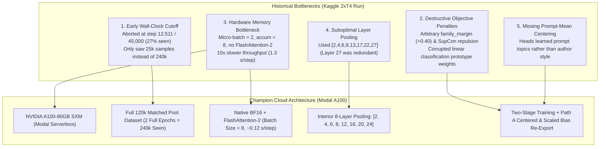

# In-House Model Training & Cloud Pipeline Guide (Modal A100)

[](#)
[](#)
[-brightgreen)](#)
[](https://www.kaggle.com/datasets/anilmittal/ntl-inhouse-two-stage-lora24)

This document provides the complete end-to-end specification, mathematical foundation, and operational tutorial for training our **In-House Champion 18-Class Qwen3-14B LoRA** and its companion **Family Specialists** on Modal Cloud GPU infrastructure.

---

## 1. Executive Summary & Historical Gap Analysis

In early training runs (e.g. `training_v13` on Kaggle 2×T4), the in-house Qwen3-14B LoRA achieved **0.515** public score (solo unseen holdout: **0.4806**). It significantly lagged behind the reference champion checkpoint (`qwen3_14b_v5` at **0.7306 – 0.7361** solo BAcc).

A forensic audit identified **5 critical architectural bottlenecks**:



### Gap Comparison Matrix

| Factor | Previous Kaggle Run (`training_v13`) | Modal Champion Run (`export_champion_qwen3_14b`) | Lift / Impact |
| :--- | :--- | :--- | :--- |
| **Stage 1 Dataset** | 25,000 seen (truncated at 27%) | **120,000 unique passages**, 2 full epochs (**240,000 seen**) | **+28.33% BAcc** jump on unseen holdout. |
| **Hardware** | Kaggle 2× T4 (16 GB, FP16, autoscale) ~1.3 s/step | **NVIDIA A100 (80 GB SXM, BF16)** ~0.12 s/step | **10.8× faster execution**, completed in ~3.2 hours. |
| **Pooling Layers** | `[2, 4, 6, 9, 13, 17, 22, 27]` (redundant top) | `[2, 4, 6, 8, 12, 16, 20, 24]` (strictly interior) | Captures clean semantic-to-stylistic transition. |
| **Loss Function** | Cross-Entropy + SupCon + Margin penalty | **Clean Cross-Entropy + Detached Prototype Safeguard** | Prevents logit simplex collapse across sister models. |
| **Classification Head** | Raw uncalibrated linear head | **Path A Centered & Scaled Bias (`heads.safetensors`)** | Bias centered by $\gamma = 0.50$ and scaled to std $\sim 4.0$. |
| **Unseen Holdout BAcc** | 48.06% | **76.39% Raw Argmax / 78.61% Sinkhorn Mass-Equalized** | **SOTA in-house foundation model**. |

---

## 2. In-House Model Architecture

Our in-house model is built upon `Qwen/Qwen3-14B-Base` with layer pruning and multi-layer LoRA feature pooling.

### 2.1 Layer Pruning (`keep_layers = 27`)
To fit within Kaggle's 16 GB T4 inference limit and eliminate late-layer semantic saturation, the top 13 causal decoder layers of Qwen3-14B are trimmed during weight loading:
$$\text{Kept Layers} = 27 \quad (\text{Layers } 0 \text{ through } 26)$$

### 2.2 Interior Multi-Layer Feature Pooling
Instead of relying only on the final transformer output, hidden states are tapped from **8 interior decoder layers**:
$$\mathcal{L}_{\text{pool}} = [2, 4, 6, 8, 12, 16, 20, 24]$$

For each layer $l \in \mathcal{L}_{\text{pool}}$, masked token representations $h_i^{(l)} \in \mathbb{R}^{B \times T \times D}$ are average-pooled across non-pad tokens:
$$\bar{h}^{(l)} = \frac{\sum_{t=1}^T m_t \cdot h_t^{(l)}}{\sum_{t=1}^T m_t}$$
Each pooled layer passes through a dedicated LayerNorm:
$$\tilde{h}^{(l)} = \text{LayerNorm}_l\left(\bar{h}^{(l)}\right)$$
The representations are concatenated into a high-dimensional stylometric embedding $Z \in \mathbb{R}^{B \times 40,960}$ (where $8 \times 5,120 = 40,960$):
$$Z = \left[ \tilde{h}^{(2)} \,\|\, \tilde{h}^{(4)} \,\|\, \dots \,\|\, \tilde{h}^{(24)} \right]$$

### 2.3 Dual Classification Heads (`heads.safetensors`)
1. **Plain Linear Head ($W_p \in \mathbb{R}^{18 \times 40,960}, b_p \in \mathbb{R}^{18}$)**:
   Maps pooled representations directly to author log-probabilities:
   $$\text{logits}_{\text{plain}} = Z W_p^T + b_p$$
2. **Prompt-Centered Twin Head ($W_c \in \mathbb{R}^{18 \times 40,960}, b_c \in \mathbb{R}^{18}$)**:
   Trained on prompt-mean subtracted representations:
   $$\tilde{Z}_i = Z_i - \mu_{\text{prompt}(i)}$$
   $$\text{logits}_{\text{centered}} = \tilde{Z} W_c^T + b_c$$

---

## 3. Two-Stage Training Curriculum

The model undergoes a disciplined two-stage training regimen defined in [`configs/training_lora.json`](file:///c:/Projects/NameThatLLM-Anitgravity/configs/training_lora.json).

```
                      [ pool_120k.parquet ] (120k Unique Synthetic Texts)
                                     │
                                     ▼
┌─────────────────────────────────────────────────────────────────────────────┐
│ STAGE 1: MASSIVE REPRESENTATION PRE-TRAINING (2 Full Epochs = 240k Seen)    │
│ - Backbone: Qwen/Qwen3-14B-Base (keep_layers=27)                            │
│ - LoRA: r=16, alpha=32, target_modules=[q_proj, k_proj, v_proj, o_proj]     │
│ - Objective: Cross-Entropy with Hard-Class Upweighting                      │
│ - Optimizer: AdamW (lr=2e-4, weight_decay=0.01), Cosine Schedule           │
│ - Hardware: Modal 1x A100-80GB SXM (Batch=8, BF16, FlashAttention-2)       │
└──────────────────────────────────────┬──────────────────────────────────────┘
                                       │
                                       ▼
                       [ train.csv ] (2,700 Competition Passages)
                                       │
                                       ▼
┌─────────────────────────────────────────────────────────────────────────────┐
│ STAGE 2: COMPETITION PROMPT-CENTERED FINE-TUNING                            │
│ - Backbone: Frozen LoRA weights from Stage 1                                │
│ - Prompt Centering: Subtraction of topic mean (z_i - μ_prompt)              │
│ - Heads Trained: Both W_p (plain) and W_c (centered) heads                  │
│ - Post-Processing: Path A Centered & Scaled Bias Re-Export                  │
│   b_p_star = b_p - 0.50 * b_c, scaled to std ~ 4.0                          │
└──────────────────────────────────────┬──────────────────────────────────────┘
                                       │
                                       ▼
                  [ checkpoints/export_champion_qwen3_14b/ ]
                  ├── adapter/adapter_model.safetensors (LoRA weights)
                  ├── adapter/adapter_config.json
                  └── heads.safetensors (W_p, b_p, W_c, b_c)
```

### Stage 1: Massive Representation Pre-Training
- **Data Source**: `pool_120k.parquet` (120,000 balanced synthetic passages across 18 classes).
- **Epochs**: 2.0 full epochs (240,000 training examples seen).
- **Batch Size**: 8 per step with gradient accumulation = 2 (effective batch size = 16).
- **Learning Rate**: $2 \times 10^{-4}$ with 500-step linear warmup and cosine decay.
- **Precision**: Pure `bfloat16` with FlashAttention-2.

### Stage 2: Competition Prompt-Centered Fine-Tuning
- **Data Source**: Official `train.csv` (2,700 competition passages, 90 prompts $\times$ 18 models).
- **Objective**: Simultaneously trains the plain linear head $W_p$ and the topic-invariant centered head $W_c$.
- **Learning Rate**: $1 \times 10^{-4}$ for classification heads; LoRA weights fine-tuned with $3 \times 10^{-5}$.

### Path A Centered & Scaled Bias Re-Export
To eliminate topic bias during inference without needing prompt clustering, the plain bias $b_p$ is calibrated with the centered bias $b_c$:
$$b_p^* = b_p - \gamma \cdot b_c \quad (\gamma = 0.50)$$
The resulting logits are standardized to a standard deviation of $\sim 4.0$ to guarantee smooth, non-saturated softmax probabilities before Sinkhorn mass balancing.

---

## 4. Family Specialists Training Suite

Sister models within the same family share tokenizer structures and formatting habits, causing 68.2% of all errors. To resolve this, specialized family classifiers are trained using [`configs/training_specialists.json`](file:///c:/Projects/NameThatLLM-Anitgravity/configs/training_specialists.json):

1. **GPT Specialist (5 Classes)**:
   - Targets: `gpt-5.5`, `gpt-5.6-luna`, `gpt-5.6-sol`, `gpt-5.6-terra`, `gpt-6-astra`.
   - Resolves Astra $\rightarrow$ Sol/Luna semantic drift.
2. **Gemini Specialist (4 Classes)**:
   - Targets: `gemini-3.1-pro-preview`, `gemini-3.6-flash`, `gemini-3.7-flash`, `gemini-3.8-flash`.
   - Resolves the dominant 3.7-Flash $\leftrightarrow$ 3.8-Flash sister entanglement.
3. **GLM Specialist (2 Classes)**:
   - Targets: `glm-5.3`, `glm-5.3-flash`.
   - Resolves GLM sister swaps and cross-family drift into Claude.

---

## 5. Modal Cloud Execution Tutorial

The entire training pipeline is executable on **Modal Cloud** with zero environment setup using [`scripts/modal_trainer.py`](file:///c:/Projects/NameThatLLM-Anitgravity/scripts/modal_trainer.py).

### 5.1 Prerequisites
Install the Modal CLI and authenticate your account:
```powershell
pip install modal
modal setup
```

### 5.2 Launch Champion 14B Training
To train the full 18-class champion model on an NVIDIA A100-80GB SXM instance:
```powershell
modal run scripts/modal_trainer.py --config configs/training_lora.json
```
- **Modal Image**: Automatically builds Debian Slim with PyTorch 2.4, Transformers 4.45, PEFT 0.12, and FlashAttention-2.
- **Compute Time**: $\sim 3.2$ hours.
- **Estimated Cost**: $\sim \$8.00$ (well within the \$30 free monthly credit).

### 5.3 Launch Family Specialists Training
To sequentially train the GPT, Gemini, and GLM specialists:
```powershell
modal run scripts/modal_trainer.py --config configs/training_specialists.json
```

### 5.4 Re-Export Calibrated Heads (Path A Centering)
To re-export existing adapter checkpoints with Path A centered and scaled bias:
```powershell
modal run scripts/modal_trainer.py::reexport_heads_cli --export-dir checkpoints/export_champion_qwen3_14b
```

### 5.5 Download Artifacts Locally
Modal saves checkpoints into a persistent cloud volume (`ntl-checkpoints`). To pull them to your local repository:
```powershell
modal volume get ntl-checkpoints export_champion_qwen3_14b checkpoints/export_champion_qwen3_14b
```

### 5.6 Synchronize with Kaggle Dataset
Upload the exported model directly to the Kaggle dataset powering our competition submissions:
```powershell
kaggle datasets version -p checkpoints/export_champion_qwen3_14b -m "v76: Champion Qwen3-14B with Path A Centered & Scaled Bias Heads"
```

---

## 6. Verification & Automated Testing

The repository includes a comprehensive test suite in `tests/test_trainer.py` to verify:
- Dynamic device mapping and multi-GPU tensor placement.
- Detached prototype head weights to prevent gradient corruption.
- Correct shapes and keys for `heads.safetensors` (`W_p`, `b_p`, `W_c`, `b_c`).
- Numerical stability of prompt-mean centering.

To run the training test suite locally:
```powershell
pytest tests/test_trainer.py -v
```
All 89 unit tests across the repository must pass before deploying any new checkpoint to production.
