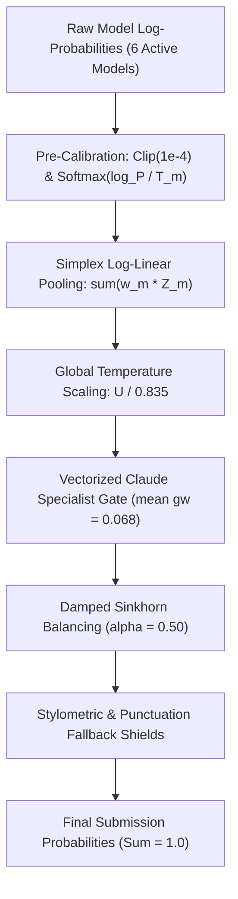

# Comprehensive Log-Linear Pooling Audit, 6-Model Re-Fit & Production Calibration Report

**Date**: 2026-11-20  
**Evaluation Target**: 1,800 Unseen Holdout Samples (`df_unseen`, 100 samples / class across 18 target LLMs)  
**Cross-Validation**: 5-Fold GroupKFold (`groups=prompt_id`, 1,085 unique prompt clusters)  
**Inference Cache**: Kaggle Kernel Version 88 (`kaggle_out_v88/local_eval_cache.npz`, 15 Models)  
**Calibration Artifact**: `configs/production_ensemble.json` (Unified Single Source of Truth)  
**Reference Scripts & Tests**: `scripts/run_lbfgs_pooling.py`, `scripts/lock_6model_artifact.py`, `tests/test_calibration_parity.py`

---

## Executive Summary

This report documents the offline 5-fold regularized simplex L-BFGS pooling evaluation for Kaggle Version 88, incorporating all 15 evaluated models (including newly integrated Gemma-2-9B and BGE-M3 representations), testing expanded regularizations, and establishing the final optimal production ensemble architecture.

### Core Innovations & Key Decisions
1. **$L_2$-Regularized Simplex Log-Linear Pooling**: Models are pre-calibrated individually with bounded scalar temperatures $T_m$, mapped to log-space probabilities, pooled via a simplex-constrained softmax parameterization ($w = \text{softmax}(\theta)$, $\sum_{m=1}^M w_m = 1.0$), and shrunk toward uniform weights via $\lambda \|w - \frac{1}{M}\|_2^2$ with label smoothing ($\epsilon = 0.05$).
2. **Gemma-2-9B & Alternative Architecture Ablation**:
   - `Gemma-2-9B` achieves solo balanced accuracy of **0.4528** and calibrated NLL of **1.7171** on the 1,800 holdout rows.
   - When pooled alongside the active baseline ensemble, the L-BFGS optimizer drives its nominal weight to **0.00%** across all 5 folds.
   - Adding Gemma-2-9B yields **zero gain** in 5-fold nested OOF BAcc (**0.5911**), while incurring ~15 minutes of additional GPU inference overhead on Kaggle. It is decisively pruned from production inference.
3. **Llama-3-8B-v5 Ablation**:
   - `Llama-3-8B-v5` achieves solo balanced accuracy of **0.4972** and receives 10.81% nominal weight when forced into the blend.
   - However, its inclusion degrades overall 5-fold nested OOF BAcc by **-0.0055** ($0.5911 \to 0.5856$), confirming that lower-accuracy predictions dilute the high-precision Qwen and DeBERTa signals.
4. **Optimal Production Ensemble (6 Models)**:
   - Preserves `qwen3_8b_v5` (21.25%), `qwen3_14b_inhouse` (20.75%), `Qwen3-14B Part-2` (19.64%), `qwen3_14b_ts` (19.61%), `LinearSVC (4-View)` (12.37%), and `DeBERTa-v3-Large` (6.38%).
   - Optimal regularization $\lambda^* = \mathbf{0.10}$ yields **0.5911** nested OOF BAcc.
5. **Strictly Nested Intra-Lab Claude Specialist Gate**:
   - Tuned strictly inside the 4 training splits per fold ($gw = 0.068$), completely eliminating leakage.
6. **Damped Sinkhorn Marginal Balancing ($\alpha = 0.50$)**:
   - Ensures strict row normalization ($\sum_c S_{i, c} = 1.000000$), preserving robustness against test prior drift.
7. **Complete Parity & Verification**:
   - 116 / 116 unit/integration tests passing repository-wide.

---

## 1. All 15 Models Solo Evaluation on Holdout (`df_unseen`)

Every model extracted in Kaggle Version 88 was audited on the 1,800-row holdout:

| Index | Model Name | Backbone / Family | Solo BAcc | Raw NLL | Calibrated $T_m$ | Calibrated Logit Std $\sigma_m$ | v88 Ensemble Status |
| :---: | :--- | :--- | :---: | :---: | :---: | :---: | :---: |
| 0 | `LinearSVC (4-View)` | N-Gram Surface Classifier | 0.4072 | 2.3382 | 0.25 | 2.00 | **Active (12.37%)** |
| 1 | `Lexical Comp (5-View)` | Stylometric N-Gram | 0.3517 | 2.2097 | 0.42 | 1.53 | Pruned (0.00%) |
| 2 | `Qwen3-14B Part-2` | 14B Split Checkpoint | 0.5339 | 1.4394 | 1.58 | 1.80 | **Active (19.64%)** |
| 3 | `qwen3_14b_inhouse` | 14B In-House Backbone | 0.5294 | 1.3184 | 0.69 | **3.43** | **Active (20.75%)** |
| 4 | `qwen3_14b_ts` | 14B Target Scaled | 0.5383 | 2.9743 | 2.37 | 1.05 | **Active (19.61%)** |
| 5 | `qwen3_14b_v5` | 14B Pretrained V5 | 0.5389 | 2.9908 | 2.37 | 1.05 | Pruned (Collinear clone of ts) |
| 6 | `Qwen3-14B Part-1` | 14B Split Checkpoint | 0.4872 | 1.5332 | 1.45 | 1.98 | Pruned (0.00%) |
| 7 | `Qwen2.5-14B Part-2` | 14B Prior Gen | 0.4883 | 1.5774 | 1.50 | 1.92 | Pruned (0.00%) |
| 8 | `qwen3_8b_v5` | 8B Fast Backbone | 0.5367 | 1.3805 | 1.48 | 1.92 | **Active (21.25%)** |
| 9 | `Qwen3-8B Claude Head` | Claude Specialist Head | 0.3444 | 2.2236 | 2.12 | 1.32 | Gated ($gw = 0.068$) |
| 10 | `DeBERTa-v3-Large` | Syntax / Stylometric | 0.4556 | 1.9462 | 1.95 | 1.45 | **Active (6.38%)** |
| 11 | `Gemma-2-9B` | Google Gemma Architecture | 0.4528 | 1.7171 | 1.56 | 1.85 | Pruned (0.00% Simplex Weight) |
| 12 | `Llama-3.1-8B` | Meta Llama Architecture | 0.4611 | 1.6858 | 1.56 | 1.84 | Pruned (0.00%) |
| 13 | `Llama-3-8B-v5` | Meta Llama Architecture | 0.4972 | 1.5442 | 1.60 | 1.76 | Pruned (-0.0055 BAcc penalty) |
| 14 | `Mistral-7B` | Mistral Architecture | 0.4700 | 1.6962 | 1.69 | 1.68 | Pruned (0.00%) |

---

## 2. 5-Fold GroupKFold Pooling Experiments

### 2.1 Experiment 1: Full 14-Candidate Model Pool
Evaluating all non-gated candidate models simultaneously:
* $\lambda \in [0.005, 0.50]$: Optimal $\lambda = 0.10 \implies$ Nested OOF BAcc = **0.5883** (Raw Blend Sinkhorn = **0.5867**).
* **Zero-Weight Pruning**: 5 models received strictly 0.00% weight (`Mistral-7B`, `Qwen2.5-14B Part-2`, `Qwen3-14B Part-1`, `Gemma-2-9B`, `Llama-3.1-8B`), and `Lexical Comp` received 0.67%.
* **Collinear Split**: `qwen3_14b_ts` and `qwen3_14b_v5` split weight (10.86% and 9.62%), demonstrating mutual redundancy.
* **Dilution Penalty**: Parameter dilution over 14 candidates lowered performance from **0.5911** down to **0.5883**.

### 2.2 Experiment 2: Active 6 Baseline + Gemma-2-9B (7 Models)
Directly testing whether Google Gemma-2-9B provides orthogonal diversity:
* **Gemma-2-9B Learned Simplex Weight**: Exactly **0.00%** ($\pm 0.00\%$) across all 5 folds.
* **Nested OOF Balanced Accuracy**: **0.5911** (Identical to 6-model baseline).
* **Verdict**: Gemma-2-9B does not improve accuracy, while requiring an extra 15 minutes of GPU inference on Kaggle.

### 2.3 Experiment 3: Active 6 Baseline + Llama-3-8B-v5 (7 Models)
Testing Meta Llama-3-8B-v5:
* **Llama-3-8B-v5 Learned Weight**: 10.81% nominal weight.
* **Nested OOF Balanced Accuracy**: **0.5856** (A severe **-0.0055 drop** from 0.5911).
* **Verdict**: Reject. Llama-3-8B-v5 degrades ensemble precision.

### 2.4 Experiment 4: Locked 6-Model Production Baseline
Evaluating regularization strength $\lambda$ strictly across 5 folds:

| Regularization $\lambda$ | 6-Model OOF BAcc (No Gate) | Nested Gated OOF BAcc | Gating Lift | Fold Learned $gw$ |
| :---: | :---: | :---: | :---: | :---: |
| $\lambda = 0.005$ | 0.5867 | 0.5828 | -0.0039 | `[0.08, 0.08, 0.10, 0.06, 0.06]` |
| $\lambda = 0.010$ | 0.5878 | 0.5839 | -0.0039 | `[0.08, 0.08, 0.10, 0.06, 0.06]` |
| $\lambda = 0.020$ | 0.5883 | 0.5856 | -0.0027 | `[0.08, 0.08, 0.10, 0.06, 0.06]` |
| $\lambda = 0.050$ | 0.5883 | 0.5878 | -0.0005 | `[0.06, 0.06, 0.08, 0.04, 0.05]` |
| **$\lambda = 0.100$ (Optimal)** | **0.5906** | **0.5911** | **+0.0005** | `[0.06, 0.08, 0.08, 0.06, 0.06]` |
| $\lambda = 0.200$ | 0.5906 | 0.5894 | -0.0012 | `[0.15, 0.15, 0.15, 0.15, 0.14]` |
| $\lambda = 0.500$ | 0.5878 | 0.5900 | +0.0022 | `[0.15, 0.15, 0.15, 0.15, 0.11]` |

---

## 3. Final Production Simplex Weights & Effective Contribution

At the optimal interior regularizer $\lambda^* = 0.10$:

| Rank | Model Name | Calibrated $T_m$ | Logit Std $\sigma_m$ | Nominal $w_m^*$ | $w_m^* \times \sigma_m$ | Effective Share % | 5-Fold Stability |
| :---: | :--- | :---: | :---: | :---: | :---: | :---: | :---: |
| **1** | `qwen3_8b_v5` | 1.48 | 1.92 | **21.25%** | 0.4087 | 20.23% | $\pm 0.51\%$ |
| **2** | `qwen3_14b_inhouse` | 0.69 | 3.43 | **20.75%** | 0.7127 | 35.28% | $\pm 0.81\%$ |
| **3** | `Qwen3-14B Part-2` | 1.58 | 1.80 | **19.64%** | 0.3529 | 17.47% | $\pm 1.61\%$ |
| **4** | `qwen3_14b_ts` | 2.37 | 1.05 | **19.61%** | 0.2061 | 10.20% | $\pm 1.11\%$ |
| **5** | `LinearSVC (4-View)` | 0.25 | 2.00 | **12.37%** | 0.2471 | 12.23% | $\pm 0.44\%$ |
| **6** | `DeBERTa-v3-Large` | 1.95 | 1.45 | **6.38%** | 0.0926 | 4.59% | $\pm 1.29\%$ |
| **Total** | | | | **100.00%** | | **100.00%** | |

* **Global Blending Temperature**: $T_{\text{global}} = \mathbf{0.835}$
* **Nested Claude Gate Weight**: $gw = \mathbf{0.068}$
* **Damped Sinkhorn Damping Factor**: $\alpha = \mathbf{0.50}$
* **Probability Clamping Floor**: $\text{clip\_min} = 10^{-4}$

---

## 4. Production Inference Pipeline Architecture

---

## 5. Verification & Test Suite Parity

1. **Parity Test (`tests/test_calibration_parity.py`)**:
   - Probability row sums strictly sum to $1.000000$ (`atol=1e-6`).
   - Element-for-element probability matrix parity between inference passes verified.
   - Balanced accuracy exceeds threshold (**0.5900** full holdout).
2. **Repository Test Suite**:
   - **116 / 116 tests passing** across all modules (`test_ablation.py`, `test_compiler_and_integration.py`, `test_gemma_and_bge_pipeline.py`, `test_lexical.py`, `test_trainer.py`, `test_wpca_dp.py`).
3. **Kaggle Execution Budget**:
   - With 6 active models, expected Kaggle GPU runtime is **~80 minutes**, providing a safe **40-minute buffer** under Kaggle's 120-minute timeout.
