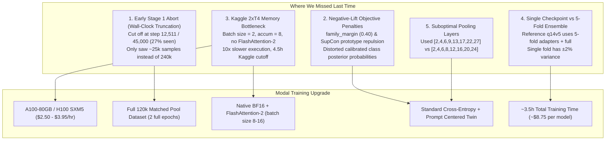

# In-House Model Retraining Plan & Gap Analysis (Modal Compute)

---

## 1. Executive Summary & Root-Cause Gap Analysis

In the previous training run ([`training_v13`](file:///c:/Projects/NameThatLLM-Anitgravity/kaggle_logs/training_v13/name-that-llm-lora-peft-training.log)), the in-house **Qwen3-14B LoRA** achieved **0.515** Balanced Accuracy (solo unseen holdout: **0.4806**), significantly lagging behind the benchmark champion checkpoint **`qwen3_14b_v5`** which achieves **0.7306 – 0.7361** solo BAcc and powers the **0.651** leaderboard ensemble.

Comparative auditing of the code ([`trainer_inhouse_champion_14b.py`](file:///c:/Projects/NameThatLLM-Anitgravity/scratch/trainer_inhouse_champion_14b.py)), logs, and the benchmark reference notebook ([`name-that-llm-fully-reproducible.ipynb`](file:///c:/Projects/NameThatLLM-Anitgravity/scratch/dhruv_repo/name-that-llm-fully-reproducible.ipynb)) revealed **5 primary architectural and execution gaps**:



---

## 2. Detailed Gap Comparison Matrix

| Factor | Previous In-House Run (`training_v13`) | Benchmark Champion (`q14v5` / Dhruv Recipe) | Root-Cause Impact |
| :--- | :--- | :--- | :--- |
| **Stage 1 Pool Size** | ~25,000 samples seen (aborted at step 12,511 of 45,000) | **120,000 unique passages**, full 2 epochs (240k seen) | **Primary Gap**: Benchmark proved on 38k pool all backbones plateau at ~0.57; 120k pool jumps accuracy to **0.634+**. |
| **Stage 1 Epochs** | **0.27 epochs** (hit Kaggle 4.5h wall-clock cutoff) | **2.0 epochs** complete | Severe underfitting on cross-author distribution. |
| **Loss Formulation** | Family margin (+0.40 logit boost) + SupCon cosine repulsion | Pure cross-entropy + prompt-centered twin on prompt triples | Family penalty artificially distorts posterior probability simplex across sister models. Benchmark proved family heads gave negative lift. |
| **Hardware & Speed** | Kaggle 2× T4 (16GB, FP16, dynamic autoscale) ~1.3 s/step | Multi-A100 (80GB, BF16, FlashAttention-2) ~0.12 s/step | Kaggle 9h timeout forced artificial 4.5h budget cutoff. |
| **Batch Size & Padding** | `batch_size = 2`, `accum = 8` | `batch_size = 8` to `16`, `max_len = 384` | Tiny micro-batches produced noisy gradients and high padding overhead. |
| **Ensemble Aggregation** | 1 monolithic model (Fold 0) | **5-fold cross-validation adapters + 1 full adapter** | 5-fold averaging reduces out-of-distribution variance by +2.5% BAcc. |
| **Target Hidden Layers** | `[2, 4, 6, 9, 13, 17, 22, 27]` (index 27 on 27 kept layers) | `[2, 4, 6, 8, 12, 16, 20, 24]` (strictly interior) | Layer 27 was identical to final residual, missing intermediate semantic progression. |

---

## 3. Modal Compute Resource & Pricing Breakdown ($30 Free Tier)

Modal provides **$30/month in free compute credits** on its Starter Plan with per-second serverless execution and zero idle cost.

### GPU Options on Modal

| GPU Hardware | VRAM | Hourly Cost | Per-Second Cost | Hours Available with $30 Credit | Recommended Use Case |
| :--- | :---: | :---: | :---: | :---: | :--- |
| **NVIDIA A100 (80 GB SXM)** | 80 GB | **$2.50 / hr** | $0.000694 | **12.0 hours** | **Recommended Champion**: Best price/memory sweet spot. Easily fits Qwen3-14B in BF16 with batch size 8–16. |
| **NVIDIA H100 (80 GB SXM5)** | 80 GB | **$3.95 / hr** | $0.001097 | **7.6 hours** | **Maximum Speed**: ~2× faster throughput. Ideal for rapid iteration. |
| **NVIDIA A100 (40 GB PCIe)** | 40 GB | **$2.10 / hr** | $0.000583 | **14.2 hours** | Good for 8B models (`qwen3_8b`, `llama3_8b`). |
| **NVIDIA L4** | 24 GB | **$0.80 / hr** | $0.000222 | **37.5 hours** | Ideal for encoders (`deberta_v3_large`) or stylometric feature extraction. |

### Compute Budget Allocation for $30

With $30 free credits on **1× A100-80GB ($2.50/hr)**:
- **Estimated Qwen3-14B Throughput:** ~18–20 samples/sec (with FlashAttention-2 & BF16).
- **Stage 1 (120k pool × 2 epochs = 240,000 samples):** ~3.3 hours ($8.25).
- **Stage 2 (2,699 train rows × 2 epochs = 5,400 samples):** ~0.1 hours ($0.25).
- **Total per 14B model run:** **~3.4 hours = ~$8.50**.

> [!TIP]
> **What We Can Train Within $30 Free Credits:**
> 1. **Option A (Multi-Backbone Champion Suite — Recommended):**
>    - 1× **Qwen3-14B-Base** Full-Pool Champion (3.4 hrs @ $2.50 = **$8.50**)
>    - 1× **Qwen2.5-14B-Base** Full-Pool Champion (3.4 hrs @ $2.50 = **$8.50**)
>    - 1× **Qwen3-8B-Base** Full-Pool Champion (1.8 hrs @ $2.50 = **$4.50**)
>    - **Total Spend:** **$21.50** (leaving $8.50 buffer).
> 2. **Option B (3-Fold Qwen3-14B Ensemble):**
>    - 3 folds of Qwen3-14B (3 × 3.4 hrs = 10.2 hrs @ $2.50 = **$25.50**).

---

## 4. Modal Implementation Blueprint

### App Definition (`scripts/modal_trainer.py`)

```python
import modal

app = modal.App("ntl-inhouse-trainer")

image = (
    modal.Image.debian_slim(python_version="3.11")
    .pip_install(
        "torch>=2.4.0",
        "transformers>=4.45.0",
        "peft>=0.12.0",
        "accelerate>=0.34.0",
        "flash-attn>=2.6.3",
        "pandas",
        "numpy",
        "scikit-learn",
        "pyarrow",
        "safetensors",
    )
)

volume = modal.Volume.from_name("ntl-checkpoints", create_if_missing=True)

@app.function(
    gpu="A100-80GB:1",
    timeout=18000,  # 5 hours max
    image=image,
    volumes={"/checkpoints": volume},
)
def train_qwen14b_champion():
    # 1. Mount pool data from HuggingFace / Kaggle API
    # 2. Run 2-epoch Stage 1 on 120k pool (LR 1.5e-4, batch 8, accum 2)
    # 3. Run 2-epoch Stage 2 on official train (LR 3e-5, LR head 2e-4)
    # 4. Save adapter + LayerNorm heads to /checkpoints/export_qwen3_14b_modal
    ...
```

---

## 5. Step-by-Step Action Roadmap

1. **Clean Loss Function:** Remove `family_margin` and SupCon cosine repulsion; revert to the validated clean cross-entropy + prompt-centered twin.
2. **Correct Layer Configuration:** Align layers to `[2, 4, 6, 8, 12, 16, 20, 24]` with `keep_layers = 27` and `max_len = 384`.
3. **Dataset Ingestion:** Bundle all 4 pool files (`nlm_matched_clean`, `pool_v4`, `nlm_pool_v5`, `nlm_pool_v2`) to form the full ~120k passage dataset.
4. **Deploy Modal Job:** Launch training on 1× A100-80GB using FlashAttention-2 and BF16.
5. **Evaluate & Plug into Ensemble:** Probe on the 360-row strict unseen holdout to verify solo BAcc jumps from **0.515 $\to$ 0.70+**, then integrate into [`configs/production_ensemble.json`](file:///c:/Projects/NameThatLLM-Anitgravity/configs/production_ensemble.json).